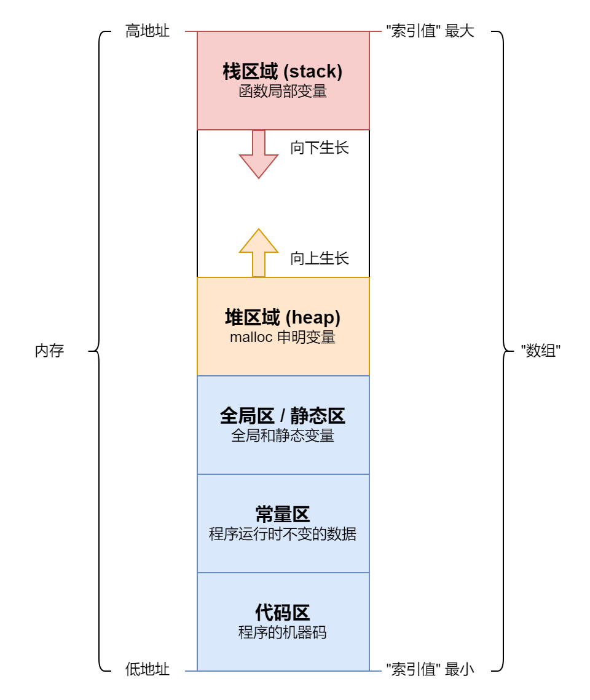

# (一) C语言内存模型

[TOC]

在高级编程语言中, C 语言是元老级别的语言, 同时也是难以掌握的语言。C 语言很难学习的原因主要有三点: 不成熟的类型系统、不清晰的语法结构 以及 独特的内存模型。本文以 内存模型 为切入点, 重新认识一下 变量、指针等概念, 并看看 C++ 中是如何优化语法结构的。下面让我们开始吧 ~

## 一、内存模型

### 1.1 内存模型简介



图一是程序运行的经典内存模型, 一共分为五个区域: 代码区、常量区、全局区、堆区域 和 栈区域。"代码区" 存放的是程序执行的机器码; "常量区" 主要存放的是 **常数变量** (由 `const` 关键词修饰的变量); "全局区" 主要存放 **全局变量** (代码块之外定义的变量) 以及 **静态变量** (由 `static` 关键词修饰的变量); "堆区域" 主要存放由 `malloc` 函数或者 `new` 运算符分配的内存空间; "栈区域" 主要存放函数的 **局部变量**。

在程序运行的阶段, 代码区、常量区、全局区 的内存空间都是固定的, 只有 堆区域 和 栈区域 的内存空间会变动。堆区域 (heap) 往上扩展空间, 栈区域 (stack) 往下扩展空间。当两者相遇时, 就会报内存溢出错误。那么, 为什么要这样设计呢? 对于一个数组来说, 如果我们需要两个可以动态扩容的区域, 最简单的方式就是: 一个 从前往后 (向上) 扩展空间; 另一个 从后往前 (向下) 扩展空间。

上面是 "经典内存模型", 在现代化的操作系统中, 并不是按照上述方式管理内存。一般情况下, 程序 栈区域 最大空间是确定的, 在 Linux 操作系统中我们可以用 `ulimit -s` 指令查看, 默认为 8MB。堆区域 最大空间则没有限制, 计算机剩余多少内存你就能申请多少。但是, 很多 计算机体系知识 都是建立在 "经典内存模型" 之上, 新版的内存模型往往也是兼容 "经典内存模型" 的, 比方说 栈空间 是 从后往前 扩展内存空间的, 因此一定要理解 "经典内存模型", 这一点非常重要。下面, 让我们借助 汇编代码 来学习一下 栈区域 的内存管理方式。

### 1.2 栈区域内存管理

```c
int addOne(int x) {
    x = x + 1;
    return x;
}
int main() {
    int a = 100;
    a = addOne(a);
}

```

上述 C 语言代码, 在 [godbolt](https://godbolt.org/) 选择 RISC-V rv64gc clang 22.1.0 后的汇编代码如下:

```armasm
addOne(int):
        addi    sp, sp, -32  ; 第 01 行: 函数预处理
        sd      ra, 24(sp)   ; 第 02 行: 函数预处理
        sd      s0, 16(sp)   ; 第 03 行: 函数预处理
        addi    s0, sp, 32   ; 第 04 行: 函数预处理
        sw      a0, -20(s0)  ; 第 05 行: 入参
        lw      a0, -20(s0)  ; 第 06 行: x = x + 1;
        addiw   a0, a0, 1    ; 第 07 行: x = x + 1;
        sw      a0, -20(s0)  ; 第 08 行: x = x + 1;
        lw      a0, -20(s0)  ; 第 09 行: 出参
        ld      ra, 24(sp)   ; 第 10 行: 函数后处理
        ld      s0, 16(sp)   ; 第 11 行: 函数后处理
        addi    sp, sp, 32   ; 第 12 行: 函数后处理
        ret                  ; 第 13 行: 函数后处理

main:
        addi    sp, sp, -32  ; 第 14 行: 函数预处理
        sd      ra, 24(sp)   ; 第 15 行: 函数预处理
        sd      s0, 16(sp)   ; 第 16 行: 函数预处理
        addi    s0, sp, 32   ; 第 17 行: 函数预处理
        li      a0, 100      ; 第 18 行: int a = 100;
        sw      a0, -20(s0)  ; 第 19 行: int a = 100;
        lw      a0, -20(s0)  ; 第 20 行: a = addOne(a);
        call    addOne(int)  ; 第 21 行: a = addOne(a);
        sw      a0, -20(s0)  ; 第 22 行: a = addOne(a);
        li      a0, 0        ; 第 23 行: a = addOne(a);
        ld      ra, 24(sp)   ; 第 24 行: 函数后处理
        ld      s0, 16(sp)   ; 第 25 行: 函数后处理
        addi    sp, sp, 32   ; 第 26 行: 函数后处理
        ret                  ; 第 27 行: 函数后处理

```

CPU 只会按照一定的顺序执行指令, 并不知道什么是 **函数**。**函数** 属于高级语言中的概念, 在汇编层面会被解析为 **指令跳转**, 类似于 C 语言中的 `goto` 语句。程序在运行时, 会先从 `main` 标签所在的第 14 行开始执行; 在执行到第 21 行 `call` 指令时会跳转到 `addOne(int)` 标签所在的第 1 行; 在执行到第 13 行的 `ret` 指令时会跳转到第 22 行继续执行; 在执行到第 27 行时程序运行结束。

CPU 有一个专门的寄存器: PC (Program Counter) 寄存器, 用于记录 "当前指令" 所在的内存地址。从图一中可以看出, 程序在执行时会先将 机器码 加载到内存中, 我们称为 **代码区**, PC 寄存器的数值就是 **代码区** 内部的 **内存地址**。初始状态下, PC 寄存器的数值就是 `main` 标签对应指令的 **内存地址**, 在上面的例子中就是第 14 行。为了方便描述, 我们称: 初始状态下 PC 寄存器指向第 14 行。

在执行指令时, 每执行完成一条指令, PC 寄存器会自动指向下一行。那么, 我们如何实现 **函数调用** 呢? 这就需要额外使用一个寄存器帮忙: `ra` 寄存器。在执行第 21 行 `call` 指令时, 有两个操作: (1) 让 PC 寄存器指向`addOne(int)` 标签所在的第 01 行; (2) 让 `ra` 寄存器指向下一行指令, 也就是第 22 行。这样, 接下来就会执行第 01 行指令。在执行到第 13 行 `ret` 指令时, 会将 `ra` 寄存器的值赋给 PC 寄存器, 这样 PC 寄存器就指向第 22 行, 接下来就会执行第 22 行指令了。

因此, `ra` 寄存器和 PC 寄存器相互配合, 从而可以借助 **指令跳转** 实现 **函数调用**。从上面可以看出, 汇编代码也是有隐藏操作的: 将 PC 寄存器的操作都隐藏起来。除了像 `call` 和 `ret` 这样会改变 PC 寄存器值的指令之外, 其它指令都有一个隐藏操作: 让 PC 寄存器的值指向相邻的下一条指令。这一点一定要理解!

那么, 在 **跳转** 过程, 函数的入参、出参是怎么传递的呢? 我们在 `main` 函数中调用了 `addOne` 函数, 那么我们将 `main` 函数称为 caller, `addOne` 函数称为 callee。`a0` 到 `a7` 是 caller 和 callee 两个函数之间传递参数的寄存器: 约定 `a0` 到 `a7` 是函数入参寄存器; `a0` 到 `a1` 是函数出参寄存器。如果函数入参超过 8 个, 那么会存在 栈空间 中; 两个函数出参寄存器, 是为了方便传递超过 64 位的一些数据, 比方说 `int128` 等等。这些内容超出本文的范畴, 就不做分析了。

除了 PC 寄存器, `ra` 寄存器, `a0` 到 `a7` 寄存器 之外, 还需要介绍两个寄存器: `sp` 和 `s0` 寄存器。程序在初始化运行时, 除了让 PC 寄存器指向代码区 `main` 标签的指令之外, 还会让 `sp` 寄存器指向 **栈区域** 的顶部。和 PC 寄存器不同的是, `sp` 寄存器是需要我们在代码中自行维护的。`s0` 的功能和 `sp` 是相似的, 可以不需要它, 但是由于历史原因, 其还存在。一般情况下, 我们会将 `sp` 称为 "栈指针"; `s0` 称为 "帧指针"。下面, 让我们看看使用 `sp` 寄存器从内存中 加载/存储 数据的指令:

`sw` 指令的含义是 store word; `sd` 指令的含义是 store doubleword。在 汇编语言 中, word 是四个字节, doubleword (dword) 是八个字节。那么, `sw a0, -20(s0)` 的含义是将 `a0` 寄存器的值保存到 `[s0 - 20, s0 - 17]` 的内存空间中; `sd ra, 24(sp)` 的含义是将 `ra` 寄存器中的值保存到 `[sp + 24, sp + 31]` 的内存空间中。

`lw` 指令的含义是 load word; `ld` 指令的含义是 load doubleword。同上理, `lw a0, -20(s0)` 的含义是将 `[s0 - 20, s0 - 17]` 内存空间加载到 `a0` 寄存器中; `ld s0, 16(sp)` 的含义是将 `[sp + 16, sp + 23]` 内存空间加载到 `s0` 寄存器中。

在汇编语言中, 常量一般被称为 **立即数** (immediate)。`li` 指令的全称是 load immediate 加载立即数, `li a0, 100` 的含义是将 `a0` 寄存器赋值为 `100`; `addi` 指令的全称是 add immediate, `addi sp, sp, -32` 的含义是 `sp` 寄存器的数值加上 `-32`。有了这些背景知识后, 我们来看看 `addOne` 函数的汇编代码:

(1) 第 01 行: `addi sp, sp, -32` 指令将 `sp` 寄存器的值减少 32。`sp` 是 **栈区域** 的内存地址, 相当于给函数申请了 32 个字节的内存空间。由于 **栈区域** 是从 "高地址" 往 "低地址" 增长的, 因此申请内存空间时是 "减法"。C 语言是编译型语言, 在程序执行的过程中就已经知道了所需的内存空间。

(2) 第 02 行: `sd ra, 24(sp)` 指令将 `ra` 寄存器的数值存储到 `[sp + 24, sp + 31]` 的内存区域内。`ra` 寄存器和 `ret` 指令相关, 将其保存到 栈空间 中的原因: 如果 `addOne(int)` 函数调用了其它函数, 那么也需要使用 `ra` 寄存器, 此时值会被覆盖。解决方案是: 预先将 `ra` 寄存器的数值存到内存中, 在函数执行完成后再加载回来 (第 10 行)。

(3) 第 03 行: `sd s0, 16(sp)` 指令将 `s0` 寄存器的数值存储到 `[sp + 16, sp + 23]` 的内存区域内。由于 callee (当前函数) 需要使用 `s0` 寄存器, caller 中 `s0` 寄存器可能已经使用了, 因此需要将其存储到内存中, 等 callee 函数执行完成后再恢复 (第 11 行)。

(4) 第 04 行: `addi s0, sp, 32` 指令将 `s0` 寄存器赋值为 `sp + 32`。此时, `s0` 是 "栈底部", `sp` 是 "栈顶部"。也就是说: callee 函数的 栈内存空间地址范围是 `[sp, s0)`。

(5) 第 05 行: `sw a0, -20(s0)` 指令将 `a0` 寄存器的数值存储到 `[s0 - 20, s0 - 17]` 的内存空间内。这个指令是处理函数入参: 我们知道, `a0` 到 `a7` 寄存器是用于两个函数间传参的。那么, C 语言代码中的 `x` 变量对应的内存区域是 `[s0 - 20, s0 - 17]`, `&x` 的值就是 `s0 - 20`。当然, 我们也可以用 `sp` 寄存器来实现: `sw a0, 12(sp)`。因此前面会说, `s0` 寄存器可有可无。

(6) 第 06 - 08 行: 这三行指令对应 C 语言代码中的 `x = x + 1;`。`lw a0, -20(s0)` 是从内存加载数据到寄存器 `a0` 中; `addiw a0, a0, 1` 是进行实际计算; `sw a0, -20(s0)` 是将数据存回内存中。这完美展示了计算机计算的方式: 加载、计算、存储。一般情况下, `lw` 和 `sw` 指令耗时远远大于 `addiw` 指令, 减少 `lw` 和 `sw` 指令就是 C语言优化的核心任务!

(7) 第 09 行: `lw a0, -20(s0)` 指令将 `[s0 - 20, s0 - 17]` 区域内的数值加载到 `a0` 寄存器中。caller 会通过 `a0` 寄存器获得 callee 函数的计算结果。从这里可以看出, `a0` 寄存器承担的功能非常之多: callee 和 caller 之间的参数传递, `x = x + 1` 计算时使用的寄存器 等等。

(8) 第 10 - 12 行: 这三行是函数的后处理, 用来恢复寄存器 `ra`, `s0` 和 `sp` 的数值。第 13 行: `ret` 指令是跳转到 `ra` 寄存器指向的指令, 也就是第 22 行。

至此, 你应该对 汇编语言 和 内存模型 有一个大致的了解。此时, 你或许会想, `addOne(int)` 的汇编代码过于繁琐: (1) 该函数没有调用其它函数, 那么就不需要将 `sp` 和 `ra` 寄存器中的数值保存到 栈空间 中; (2) 入参 和 出参 都使用的 `a0` 寄存器, 那么直接用 `addiw a0, a0, 1` 就可以了, 不需要将变量 `x` 的值保存到 栈空间 中。事实确实如此, 如果你开启 `-O1` 优化, `addOne(int)` 只有一行汇编代码: `addiw a0, a0, 1`。

额外提醒一点, 本节介绍的内容仅仅涉及到 整形计算, 不考虑 浮点数 和 字符串 等计算内容。如果你的入参是 浮点数, 指令差别会很大。这不是本节的重点, 重点在于理解 C 语言的内存模型!

### 1.3 变量简介

从内存模型中我们可以发现: C 语言中的每一个变量都是有 **内存区域** 的。比方说, `int a = 100;` 这行代码对应的汇编代码有两行: `li a0, 100` 和 `sw a0, -20(s0)`。含义是: 将 `a0` 寄存器赋值为 `100`, 并将 `a0` 寄存器中值存储到 `[s0-20, s0-17]` 的内存空间中。那么, 变量 `a` 对应的内存空间就是 `[s0-20, s0-17]`。当你进行 `a = a+1`; 计算时, CPU 会执行三条指令: 将变量 `a`, 也就是 `[s0-20, s0-17]` 内存空间内的值加载到寄存器; (2) 在寄存器中完成加法运算; (3) 将寄存器的值存储到变量 `a`, 也就是 `[s0-20, s0-17]` 的内存空间中。

在 C 语言中, 一个 **变量** 由 **类型**、**内存区域** 和 **数值** 三部分组成。对于 `int num = 100;` 来说, 变量 `num` 的类型是 `int`, 数值是 `100`, 内存区域在运行时分配。我们可以通过 `&num` 的方式获取内存区域首字节的索引, 这个 "索引值" 也被称为 "地址" 或者 "指针"。此时你可能会由疑问, 内存区域至少需要两个数值确定: "首字节地址 + 字节数量"。那么 "字节数量" 在哪里呢? 答案是藏在 类型 中。当我们加载 `char`, `short`, `long` 和 `long long` 的整形数据时, 会分别使用 `lb` (load byte), `lh` (load half word), `lw` (load word), `ld` (load double word) 指令, 它们的含义是加载 1 个, 2 个, 4 个 和 8 个字节的数据。

在 C 语言中, 我们一定要将 **变量** (variable) 和 **字面量** (literal) 分开来看。比方说, 在 `int a = 10;` 中, `a` 属于 **变量**, `10` 属于 **字面量**。在程序执行的过程中, **字面量** 一般存储在常量区, 或者以 立即数 的形式存在于指令中。变量 是可以进行取地址操作的, 而 字面量 是不能进行取地址的操作, 也就是说, `&10` 的语法是非法的, 这一点一定要注意。

在 C 语言中, 我们还需要将 **初始化** (initialization) 和 **赋值** (assignment) 操作分开看。初始化操作是定义变量时的赋值操作。举例来说, `int x;` 是 **定义** 一个变量并且没有进行 **初始化** 操作; `int x = 10;` 是 **定义** 一个变量同时进行 **初始化** 操作; `x = 10;` 是 **赋值** 操作。初始化操作 必须和 变量定义 绑在一起。如果定义变量时没有初始化操作, 那么之后就再也不能进行初始化操作了。

为什么一定要区分 初始化操作 和 赋值操作呢? 因为在某些场合下某些操作会被禁止。举例来说, 常数变量 (constant variable) 只能进行 初始化操作, 不能进行 赋值操作; 数组类型 可以进行 批量初始化操作, 但是不能进行 批量赋值操作。相关内容会在本文后续章节中介绍。

除此之外, 我们还需要区分 **常数变量** (constant variable) 和 **字面量** (literal) 两个概念。常数变量 一般简称 常量, 指的是只能进行初始化操作, 不能进行赋值操作的变量, 用 `const` 关键词修饰。字面量 指的是 表示数值的符号, 如 `6`, `2.333`, `'A'`, `"哈哈"` 等等。为了和 字面量 进行区分, 本文将 常量 称为 常数变量, 突出其是 变量 的特性。

至此, 你应该对变量有一个基本的认识了。下面, 让我们先看看 "指针" 相关的概念。

## 二、泛指针概念

### 2.1 指针介绍

下面是C语言中指针的基础用法:

```c
int a = 100;
int *ptr = &a;

printf("a=%d\n", a);
printf("ptr=%p\n", ptr);
printf("*ptr=%d\n", *ptr);
```

在上面的代码中, `a` 是一个正常的变量, 对应的内存区域存储值为 `100`。 我们可以使用 `&a` 获取 `a` 变量在内存中的地址。一般情况下, 在 32 位系统中, 内存地址是 `uint32`, 在 64 位操作系统中, 内存地址是 `uint64`。标准的指针输出格式是 `%p`, 以 16 位 16 进制的数字呈现, 等价于 `%016llx`。

`ptr` 是一个指针变量, 对应的内存区域存储值为 `a` 变量的内存地址, 一般说法是: `ptr` "指向" 变量 `a`。和 **取地址运算符** (`&`) 相互对应的是 **取值运算符** (`*`), 我们可以使用 `*ptr` 进行取值操作, 获取 内存区域 存储的数值。

我们还可以再定义一个变量, 存储值为 `ptr` 变量的内存地址, 方式为 `int **ptr2 = &ptr;`。 我们可以以此为基础, 构建任意 "嵌套层级" 的指针变量。需要注意的是, `&&a` 的写法是错误的, **取地址操作** 针对的是 "变量", 而非 "数值"。`&a` 返回的是 "数值", 我们不能对 "数值" 进行 "取地址" 的操作。但是 `**ptr2` 的写法是正确的, **取值操作** 针对的是 "数值", 而非 "变量"。因此, **取地址操作** 和 **取值操作** 并不是完全互逆操作, 主要原因是操作的对象不同。

如果你想定义一个指针变量, 其指向的内存区域值为 `100`, 按照上面的写法至少需要两步。有一种简便的写法: `int *ptr = &(int){100};`。在这里, `(int){100}` 是 **匿名对象**, 相关内容会在本文后续章节介绍。

指针类型 在定义时需要表明 内存区域 值的类型。这样程序就可以知道 取值运算符 (`*ptr`) 正确数值了。除此之外, 还有一个作用: 假设 相同类型 的数据存储在内存中相邻的位置, 那么 `ptr + 1` 就是下一个元素的地址了。当然, 这种运算的限制非常多: "指针" 和 "整数" 之间只能进行加减法, 不能进行乘除法; "指针" 和 "指针" 之间只能进行减法操作, 不能进行加乘除运算。有了这些运算符之后, 我们就可以用 "指针" 近似代替 "数组" 了, 但是不能完全取代。下面, 让我们来了解一下 数组 相关的内容。

### 2.2 数组介绍

谈及 指针, 那么就绕不开一个话题: **数组**。数组变量 定义 和 初始化 的方式如下:

```cpp
int arr1[5];  // 定义变量
int arr2[5] = {1, 2, 3, 4, 5};  // 定义变量 + 初始化
```

上面展示了数组变量 定义 和 初始化 的方式。需要注意的是: (1) 数组批量赋值的时机只有 初始化 阶段, 也就是说 `arr1 = {1, 2, 3, 4, 5};` 的写法是错误的; (2) 不能批量将元素交给另一个数组变量, 也就是说 `arr1 = arr2` 这样的写法也是错误的。如果想要实现相关功能, 必须用 循环 + 下标运算赋值 的方式实现。因此, 我们会说: 数组变量 不支持 **赋值运算**。

在 C 语言中, 数组的类型由两部分组成: 元素类型 + 元素个数。需要注意的是: 元素个数属于数组类型的一部分, 这一点非常重要! 只有知道了 元素个数, 才能知道内存区域的大小。但是, 由于历史原因, 元素类型 和 元素个数 分布在 变量名称 的左右。这是 C 语言语法设计的一大缺陷。在 C++ 中, 更推荐使用 `std::array<int, 5> arr;` 的形式来定义数组。而在大部分语言中, 元素个数不作为数组类型的一部分, 比方说 Java 中定义整形数组: `int[] arr = new int[5];`。

虽然 "元素个数" 是 "数组类型" 的一部分, 但是 C 语言并没有提供诸如 `len(arr)` 或者 `arr.size()` 等方式获取数组的元素个数。我们可以通过 sizeof 函数间接获取, 方式为: `sizeof(arr) / sizeof(arr[0])`。在这里, `sizeof(arr)` 返回的是 数组变量 的总字节数, `sizeof(arr[0])` 返回的是 单个元素 的字节数, 两者相除就是数组的元素个数了。

C 语言数组属于一个 "半成品" 类型, 很多时候会退化成指针。下面, 让我们来看看三个场景:

(1) **赋值运算**: 这个前面提到过, 假设有 `arr` 变量, 其类型是 `int[100]`, 此时 `int arr2[100] = arr;` 的写法是不允许的, 但是 `int *ptr = arr;` 的写法是却是合法的。需要提醒的是, 数组变量 只能出现在赋值运算的右侧, 即赋值给其它 指针变量; 不能出现在 赋值运算的左侧, 即不能将其它变量的值赋给 数组变量。

(2) **函数传参**: 这是 C 语言最坑的地方。当你声明一个函数 `int sum(int arr[100], int size);` 时, `arr` 并不是 数组变量, 而是 指针变量。没错, 虽然你将 `arr` 标记为 数组变量, 但是实际已经退化成 指针变量 了。如果你使用 IDE 进行编程, 此时 `arr` 的类型提醒是 `int *`。也就是说, 对于 `arr` 变量来说, 你无法通过 `sizeof(arr) / sizeof(arr[0])` 获取数组的元素个数, 只能通过额外的入参 `size`。这简直坑到极限了, 不过也能理解: 函数传参 是 赋值运算 的延续。

(3) **输出**: 这是初学者很容易进行的操作。当你输出 数组变量 时, 会直接退化成指针。标准的 数组变量 输出方式: `printf("%p\n", arr);` 。

很多人会说, 数组变量 和 指针变量 是等价的, 数组变量 就是 首元素的指针。这么说主要有三个原因: (a) 数组变量 绝大多数情况下会退化成 指针变量, 上面已经给出一些场景了; (b) 两者都支持 **加法运算**, **取值运算** 和 **下标运算**, `arr[1]` 和 `*(arr + 1)` 的结果是一样的; (c) 两者的下标运算都没有边界检查。那么, 数组变量 和 指针变量 是完全等价的吗? 并不是, 它们主要有以下两个区别:

1) `sizeof` 操作不同: 数组变量 返回的是 数组占用的字节数; 指针变量 固定返回 `8` (64 位操作系统) 或者 `4` (32 位操作系统)。这个在上面介绍数组元素个数时已经提及过了。

2) `&` 操作返回的数据类型不同: 对于 `int *ptr;` 来说, `&ptr` 返回的数据类型是 两层嵌套指针 `int **`, 声明变量的方式是: `int **p = &ptr;`。对于 `int arr[3];` 来说, `&arr` 返回的数据类型是 **数组指针** `int (*)[3]`, 声明变量的方式为 `int (*ptr)[3] = &a;`。

至此, 你应该对 数组 有一个大致的了解。这里特别强调一点, 千万不要将 数组 和 指针 画等号, 两者完全是不同层级的概念。在 C 语言中, 数组类型 是 "半成品", 才会有这样的问题。其它高级语言中是没有这样的问题的。最后我们来看一下两种组合类型, 非常容易弄混淆:

(a) `int (*ptr)[3]`: `ptr` 是 **数组指针**, 即 `ptr` 是 指针变量, 指向 数组。一般用 `int (*)[3]` 表示 `ptr` 类型, 常用于 二维数组 中。

(b) `int *arr[3]`: `arr` 是 **指针数组**, 即 `arr` 是 数组变量, 每一个元素是一个指针, 一般用 `int *[3]` 表示, 常用于 字符串数组 中。

上面反映出 C 语言的语法缺陷。由于 数组类型 的标识符 (`[]`) 是 变量名称 的后缀, 表示 数组指针 和 指针数组 时会有语法歧义。于是 C 语言通过加括号的方式进行区别。从这里可以看出, 指针类型 的标识符 (`*`) 就是 变量名称 的前缀。很难评价这种定义方式, 也正是因为此, 才让 C 语言入门这么难。为什么要区分这两个概念呢? 下面让我们看看 二维数组 与 二维指针。

### 2.3 多维数组

C 语言不仅支持 数组变量, 还支持 多维数组变量。多维数组 定义 和 初始化 的方式如下:

```cpp
int arr1[3][3];  // 定义 二维数组
int arr2[3][3] = {{1, 2, 3}, {4, 5, 6}, {7, 8, 9}};  // 定义+初始化
```

那么, 二维数组 会退化成什么呢? 是二维指针吗? 初想之下很合理, 实际上是错误的。假设 `arr` 是二维数组, 那么 `*arr` 是第一个子数组的内存地址, `*(arr + 1)` 是第二个子数组的内存地址。但是假设 `ptr` 是二维指针, `*(ptr + 1)` 是第二个 指针变量 的内存地址。两者的 "步长" 显然不一样。如果将 二维数组 转换成 二维指针, 是需要额外的内存空间的, 代码如下:

```c
#define num_rows 4
#define num_cols 3

int arr2[num_rows][num_cols] = {{1, 2, 3}, {4, 5, 6}, {7, 8, 9}, {10, 11, 12}};
int *arrs[num_rows] = {*(arr2 + 0), *(arr2 + 1), *(arr2 + 2), *(arr2 + 3)};
int **ptr = arrs;

for(int i = 0; i < num_rows; i++) {
    for(int j = 0; j < num_cols; j++) {
        printf("%02d ", ptr[i][j]);
    }
    printf("\n");
}
```

那么, 二维数组 会退化成什么呢? 答案是 **数组指针**。数组指针 和 二维指针 最大的不同是: 两者的 "步长" 不一致。对于任意维度的数组, 在赋值时只有 "最外层" 的数组会退化成指针, 其它层级的数组不会退化。当你声明 `int mat_sum(int mat[][10], int num_rows);` 时, `mat` 变量的实际类型为 `int (*)[10]`。下面是示例代码:

```c
int mat_sum(int mat[][10], int num_rows) {
    int num_cols = sizeof(mat[0]) / sizeof(mat[0][0]);
    int total = 0;
    for (int i = 0; i < num_rows; i++)
        for (int j = 0; j < num_cols; j++)
            total += mat[i][j];
    return total;
};

```

这里再次说明了 数组 和 指针 不能混为一谈。使用原生的多维数组并不是一个好的策略, 更好的方式是使用 "一维数组 + stride" 的方式, 具体可以参考之前的博客: [多维数组 与 NumPy](https://zhuanlan.zhihu.com/p/1928479883970974208)。

### 2.4 多维指针

那么, 二维指针有什么用呢? 现在让我们看一个例子。下面是 单向链表 删除元素的示例代码, 一共有两个版本: `remove_entry_v1` 和 `remove_entry_v2`。其中, v2 版本的代码中用到了 **两层指针**, 让我们来看看其巧妙之处。

在下面的代码中, `Entry` 结构体的 `next` 指针指向链表中的下一个元素, 或者说 `next` 指针变量的值是链表中下一个元素的内存地址。由 `next` 指针就可以构成 **链表** 数据结构了。我们可以认为链表中的元素以 `Entry *` 的形式存在。此时, `head` 就是链表的首元素, `target` 就是待删除的目标元素, `next` 就是链表中的下一个元素。

在 v1 版本的代码中, `curr` 变量就是 "遍历过程" 中的当前节点。在找到 `target` 节点后, 我们无法获取 "前一个节点", 因此需要额外的 `prev` 变量来记录。删除 `target` 节点的方式也非常简单: 让 `target` 的 "前一个节点" `next` 指针指向 `target` 的 "后一个节点"。

在 v2 版本的代码中, `p` 是当前节点的指针: (1) 初始化为 `&head` , 即第一个节点的指针; (2) 遍历过程中是 `&next`, 即下一个节点的指针。在 **取值** 时, `*p` 和 v1 版本的 `curr` 变量值相同, 两者没有任何区别。但是在 **赋值** 时, 两者差别就很大了: `curr` 是一个独立的变量, 其有自己的内存空间; 而 `p` 指针指向 `head` 或者 `next` 变量, 也就是说 `*p` 是 `head` 或者 `next` 变量, 修改 `*p` 的值相当于修改 `head` 或者 `next` 变量的值。这样, 我们就不用 `prev` 变量了, 一个 `p` 变量就可以解决任务了。

这里使用 两层指针 的原因是: (1) 链表元素以 `Entry *` 指针的形式存在; (2) 我们期望可以直接修改 `head` 或者 `next` 内存地址的值。

```c
#include <stddef.h>  // 引入 NULL 宏

typedef struct Entry {
    struct Entry *next;  // 单向链表
    // struct Entry *prev;  // 双向链表
} Entry;

Entry *remove_entry_v1(Entry *head, Entry *target) {
    Entry *prev = NULL;
    Entry *curr = head;

    while (curr != target) {
        prev = curr;
        curr = curr->next;  // curr = (*curr).next;
    }

    if (!prev) {
        head = target->next;
    } else {
        prev->next = target->next;
    }
    return head;
}

Entry *remove_entry_v2(Entry *head, Entry *target) {
    Entry **p = &head;

    while ((*p) != target) {
        p = &((*p)->next);
    }

    *p = target->next;
    return head;
}
```

C 语言中是没有异常处理机制的, 很多时候需要返回整数, 用以标识 "函数执行是否成功"。那么计算结果如何返回呢? 答案是调用函数前先定义好 "出参变量", 然后将 "出参变量" 以指针的形式作为入参, 函数内部直接修改值。在上面的代码中,  如果期望 `remove_entry` 函数返回的不是 `head` 指针, 而是 "是否操作成功", 那么入参 `Entry * head` 需要修改成 `Entry **head_ptr`。这样做的好处是: 用户可以自行决定数据存储于 栈区域 还是 堆区域。缺点自然是一大堆: 入参出参混在一起, 代码可读性差; 工程量大之后, 指针乱飞, 如何 管理内存 都是很大的问题。虽然这种做法缺陷很多, 但是属于 C 语言的常用编程泛式, 一定要理解。

### 2.5 字符串

在 C 语言中, 数组类型待遇还不错, 属于半成品类型。字符串连单独的类型都没有, 一般用指针或者数组变量来表示。声明和初始化方式如下:

```cpp
const char* str1 = "Hello, World!";
char str2[100] = "你好, 世界!";
```

需要注意的是:

(1) 在这里, `str1` 和 `str2` 是变量, `"Hello, World!"` 和 `"你好, 世界!"` 是 字面量。不同类型变量数据存储位置不同。`char *` 指针类型的字符串数据会存储在 **常量区**, 而 `char []` 数组类型的字符串会存储在 **栈区域**。这也就意味着, 第一种指针类型的字符串是不能修改字符的, 而第二种数组类型的字符串是可以修改字符的。因此, 一般会在 `char *` 类型之前增加 `const` 关键词。

(2) 两种形式的变量只能进行初始化操作, 不能进行赋值操作。也就是说, `str2 = "测试"` 和 `str2 = str1` 的语法是错误的。想要改变 `str2` 字符串中的字符, 只能用 循环 + 下标运算赋值 的方式实现, 没有其它办法。

(3) 和字符串操作相关的函数在 `string.h` 头文件中, 所有字符串都是以 `char *` 的形式作为入参的。比较经典的函数有: 长度 `strlen`; 拷贝 `strncpy`; 拼接 `strncat`; 比较 `strncmp`; 子串查找 `strstr`。额外提醒一点, `strlen` 函数是线性查找, 寻找 `\0`, 因此千万不要 "滥用" 该函数, 否则性能会很差。

(4) 在现代的 C 语言编译器中, 默认使用 UTF-8 编码。当你使用中文时, 默认按照 字节 存储。也就是说, C 语言中的 字符串 相当于高级语言中的 字节串。在示例代码中, `str2` 的值是 `你好, 世界!`, 一共占据了 15 个字节, 因此 `strlen(str2)` 返回的数值是 15, 而不是 7。那么, 我们如何遍历 字符 呢? 可以选择自行解码, 或者使用其它的第三方库。总之, 这是一个很麻烦的事情, 这里就不展开介绍了。

(5) 需要注意的是, 输出 `stdout` 的内容一定是 字节串, 不是 字符串。在 高级语言 中, 字符串输出时会自动转换成命令行的编码集, 不需要程序员操心相关问题。而在 C 语言中则不会自动转换, 程序员需要自行确保编码集正确。在 Linux 系统中, 命令行的默认编码集就是 UTF-8, 不需要做任何修改就能正确显示 `char *` 的内容。在 Windows 系统中, 命令行默认的编码集和所在地区相关, 需要引入 `windows.h` 然后调用 `SetConsoleOutputCP(65001);` 函数后才能正常显示。

(6) 在高级语言中, 字符串一般是不可变量, 对应 C 语言中的 `const char *` 类型。如果出现 "字符串替换" 的操作, 那么就新创建一个字符串对象。在 C 语言中, `string.h` 头文件并没有提供 "字符串替换" 操作函数, 需要自行实现。同时有 `char []` 类型, 即 "值可变的字符串"。注意不同语言之间的差别。

(7) 字符串数组, 建议使用 "指针数组"。比方说, 程序入参 是 `main` 函数入参, 建议写法为: `int main(int argc, char* argv[]);` 。在这里, `argc` 是程序入参个数, `argv` 数组是字符串数组。当然, `argv` 的类型标注成 `char **` 也是可以的, 但是不能标注成 `char [][]`。

C 语言字符串存在两大问题: (1) 没有独立的类型; (2) 本质上来说是 "字节串"。更多关于字符串的知识在之前的 [基础数据类型](https://zhuanlan.zhihu.com/p/2021616017365845301) 第一章已经详细介绍过了。C++ 为了解决这两个问题, 分别提供了 `std::string` 和 `std::wstring` 两个类。`std::string` 就是 C 语言字符串 `const char *` 类型的封装, 本质依旧是 "字节串", 使用 `std::cout` 文件流输出控制台。

`std::wstring` 使用的字符类型不是 `char`, 改成了 `wchar_t` 类型。`wchar_t` 是宽字符, 在 Windows 系统中是 UTF-16LE 编码, 在 Linux 系统中是 UTF-32 编码。也就是说, Windows 系统中的 `wchar_t` 占两个字节, 而 Linux 系统中的 `wchar_t` 占四个字节。下面是示例代码:

```cpp
#include <iostream>
#include <fcntl.h>

#ifdef WIN32
_setmode(_fileno(stdin ), _O_U16TEXT); // 头文件: fcntl.h
_setmode(_fileno(stdout), _O_U16TEXT); // 头文件: fcntl.h
#else
std::locale::global(std::locale(""));
#endif

std::wstring wstr = L"你好世界";
std::wcout << wstr << std::endl;
```

需要注意的有: (1) `std::wstring` 不能使用 `std::cin` 和 `std::cout` 流输入输出, 需要使用 `std::wcin` 和 `std::wcout` 流输入输出; (2) 字符串字面量之前必须添加 `L` 前缀。这里要吐槽一下 Windows 系统: C/C++ 语言都采用 Unicode 字符集了, 命令行居然还没有统一, 各国用各国的字符集, 至于吗? Win XP 系统的代码真的能 "完全不修改" 跑在 Win 11 系统上吗?

为了跨平台, C++ 11 标准又搞出了 `std::u16string` 和 `std::u32string` 类型, 分别对应 `char16_t` 和 `char32_t` 类型的字符, 分别采用 UTF-16 和 UTF-32 编码集。但是, 这两个类型并不支持控制台输入输出, 都需要手动转换成 UTF-8 字节串, 也就是 `std::string` 类型输出, 非常麻烦。总之, C/C++ 语言中使用 字符串 需要额外封装一下, 不然会很麻烦。

### 2.6 函数指针

在 C 语言中, 如果我们想将 **函数** 作为变量, 那么就需要使用 **函数指针** (Function Pointers) 的概念了。函数指针的本质是指针, 它指向函数在内存中的起始地址。下面是 函数指针 使用的示例代码:

```c
double add(int x, int y) {return x + y;}
double sub(int x, int y) {return x - y;}

double (*func_ptr)(int, int) = add;

printf("函数指针 func 的值是: %p\n", func_ptr);
printf("函数调用: %.0f\n", func(10, 20));
```

在上面的代码中, `func` 是函数指针, 其类型为 `double (*)(int, int)`, 含义是: 函数的入参是两个 `int` 类型, 出参是 `double` 类型。`func` 变量可以赋值为 `add` 函数, 也可以赋值为 `sub` 函数。函数指针规定了入参类型和出参类型, 只有当两者都相同时才能赋值, 否则会报错。需要注意的是: **函数指针** 和 **函数重载** 的匹配规则不同: 函数指针 用 入参类型 + 出参类型 进行匹配; 而 函数重载 用 函数名称 + 入参类型 进行匹配。

从上面可以看出, 函数指针类型 有和 数组类型 一样的问题, 那就是 变量名称 嵌在了类型定义中。注意下面六种语法之间的区别:

- 指针数组: `int *arr[10];`
- 数组指针: `int (*ptr)[10];`
- 函数声明: `double *func(int x, int y);`
- 函数指针: `double (*func_ptr)(int, int);`
- 函数指针数组: `double (*fp_arr[2])(int, int);`
- 函数指针指针: `double (**fp_ptr)(int, int);`

函数指针的定义中包含了小括号, 是为了避免和 函数声明 的语法混淆。至于 "函数指针数组" 和 "函数指针指针", 可以说是非常变态的定义方式。如果涉及到三层概念嵌套, 别人的代码建议用大模型解析, 自己的代码建议使用 `typedef` 解嵌套。下面是 "函数指针数组" 和 "函数指针指针" 用 `typedef` 解嵌套定义方式:

```c
typedef double (*FuncPtr)(int, int);  // C++ 中写法: using FuncPtr = double (*)(int, int);

// 函数指针数组
FuncPtr fp_arr[2] = {add, sub};  // 调用方式: fp_arr[0](10, 20)
// 函数指针指针
FuncPtr *fp_ptr = (FuncPtr []){add, sub};  // 调用方式: (*fp_ptr)(10, 20)
```

至此, 你应该对 C 语言中指针类型的定义有一个大致了解。其这么复杂的原因是: 变量名称 和 类型定义 融合在一起了, 同时函数定义没有关键词。这是 C 语言的固有缺陷, 但凡多一个  `def` 、`function`、`func`、`fn` 等这样的关键词, 代码都不会那么难读。C++ 给 C 语言打了很多补丁, 用起来方便很多。在 C++ 中, 我们可以借助 `std::function` 来定义函数指针, 做到 类型定义 与 变量名称 分离, 具体语法如下:

- 函数指针: `std::function<double(int, int)> func_ptr;`
- 函数指针数组: `std::array<std::function<double(int, int)>, 2> fp_arr;`
- 函数指针指针: `std::function<double(int, int)> * fp_ptr;`

除此之外, 我们还可以用 `auto` 和 `decltype` 避免类型的定义, 语法如下:

- `auto fp = add;`
- `decltype(&add) fp = sub;`

`auto` 关键词是让 C++ 编译器自己根据变量值来推导变量类型; `decltype` 函数则是获取已有变量的类型。有些人认为 `auto` 的写法降低了代码可读性, 这就因人而异了。

上面介绍了函数指针类型的定义方式。其使用方法非常简单, 直接当作函数调用即可, 比方说: `func_ptr(10, 20)`。这是普通指针不具备的功能。函数指针可以赋值为 `NULL`, 因此使用时需要进行非空判断。在 C 标准中, 函数指针是不能进行加减算术运算的, 但是 gcc 编译器编译能够通过。在实际开发中, 应该尽量避免这一操作, 将乱码作为 CPU 指令, 很容易引发程序崩溃。下面, 让我们看看 C 语言中如何使用 函数指针 + `void *` 进行 通用算法开发。

### 2.7 泛型编程示例

一般情况下, 排序算法需要一个比较函数, 用于比较两个元素的大小。C 语言对于类型的要求非常严格, 那么我们如何写一个通用的函数, 适配任意的类型呢? 答案是通过 `void *` 类型。`void *` 类型一般被称为 无类型指针 或者 通用指针, 其可以转换成任意类型的指针。在 C 语言的 `stdlib.h` 头文件中, 有 `qsort` 函数可以对数组进行排序。下面是使用 `qsort` 函数的示例代码:

```c
#include <stdio.h>
#include <stdlib.h>

int double_greater(const void *a, const void *b) {  // double 类型降序排序
    double a_value = *(double *)a;
    double b_value = *(double *)b;
    if (a_value > b_value) return -1;
    if (a_value < b_value) return 1;
    return 0;
}

int main() {
    double arr[10] = {2.2, 9.9, 3.3, 8.8, 4.4, 7.7, 5.5, 6.6, 1.1, 0.};
    qsort(arr, 10, sizeof(double), double_greater);

    for(int i = 0; i < 10; i++) {
        printf("%.1f ", arr[i]);
    }
    printf("\n");
}
```

`qsort` 函数一共有四个参数: (1) 数组首元素指针; (2) 数组元素个数; (3) 单个元素的字节数; (4) 两个元素的比较函数。前两个参数是 "数组变量" 必要的参数, 这在 2.2 节中已经介绍过了。由于 `arr` 变量是 `void *` 类型, 缺乏 "步长" 信息, 第三个参数就是用来弥补该信息缺失的。第四个参数就是 比较函数。在比较函数中, 入参都是 `void *` 类型, 我们需要手动转换成对应目标类型。这里的 比较函数 实现的是 `double` 类型的降序排序, 你可以实现任意类型的升降排序, 包括结构体对象。

那么, 排序函数内部是如何用 `void *` 实现泛型编程的呢? 下面让我们看一个示例: 用 选择排序 实现的通用排序。

```cpp
#include <stdio.h>
#include <stdlib.h>
#include <string.h>

typedef int (*compare_fn_t) (const void *, const void *);

void selection_sort(void *array, size_t size, size_t element_size, compare_fn_t compare_fn) {
    void *buffer = malloc(element_size);

    for(int i = 0; i < size - 1; i++) {
        void *base_ptr = (char *) array + i * element_size;

        // argmin
        void *min_ptr = base_ptr;
        for(int j = i + 1; j < size; j++) {
            void *candidate_ptr = (char *) array + j * element_size;
            if(compare_fn(min_ptr, candidate_ptr) < 0) {min_ptr = candidate_ptr;} 
        }

        // swap
        if (base_ptr != min_ptr) {
            memcpy(buffer, base_ptr, element_size);
            memcpy(base_ptr, min_ptr, element_size);
            memcpy(min_ptr, buffer, element_size);
        }
    }
    free(buffer);
}
```

选择排序的思想很简单: 不断 "选取" 未排序部分的最小值。整个过程只有两个核心操作, 一个是 `argmin`, 获取最小值对应的索引; 另一个则是 `swap`, 交换两个元素的位置。由于这里的 `array` 是 `void *` 类型, 没有 "步长" 信息, 因此我们需要使用 `(char *) array + i * element_size` 的方式来获取单个元素的指针。这一步很重要, 理解了就知道 `qsort` 函数中第三个参数的含义了!

我们可以使用上述思想实现很多算法, 包括 二分查找 等等。但是上述的 比较函数 并不能通用, 你无法实现一个 适用所有类型 的 "升序比较函数"。 C++ 中提供的解决方案是 模板。相关内容会在后续博客中介绍。

### 2.8 无类型指针

上一节提到了 `void *` 无类型指针, 本节详细介绍一下相关内容。和其它的指针不同, 无类型指针 就是纯粹的 指针, 只有地址信息, 没有 指向值的类型信息。因此, 我们不能进行 取值运算 (解引用运算), 也不能进行 加减运算。也正是因为此, 上一节中 `base_ptr` 和 `candidate_ptr` 的计算都需要将 `array` 的 `void *` 转换成 `char *` 类型。`char` 类型正好一个字节, 计算完全没有问题。

在 C 语言中, 无类型指针 可以和 其它类型指针 进行 "隐式转换"。上一节中 `base_ptr` 和 `candidate_ptr` 就是将 `char *` 类型 "隐式转换" 成 `void *` 类型。我们用 `malloc` 申请的 堆空间 返回的就是 `void *` 无类型指针, 然后就可以 "隐式转换" 成其它类型指针。

在 C 语言中, "空指针" 表示无效指针, 通常用宏 `NULL` 表示, 其定义为: `(void *) 0`。也就是说, `NULL` 的值是 `0`, 类型是 无类型指针。在你写 `int *ptr = NULL;` 时, `void *` 类型会 "隐式转换" 成 `int *` 类型。"空指针" 常用于 初始化, 或者表示错误。举例来说, 如果 `malloc` 函数返回的是 `NULL`, 那么说明内存空间申请失败。

在 C++ 语言中, "其它类型指针" 可以 "隐式转换" 成 `void *`, 但是 `void *` 不能 "隐式转换" 成 "其它类型指针"。此时, 如果将 `NULL` 宏定义为 `(void *) 0`, 就没有办法兼容 C 语言了。为了解决这一问题, C++ 将 `NULL` 宏定义为 `(int) 0`, 并允许 整数 可以 "隐式转换" 成 "其它类型指针"。此时就会产生一个问题, 在同时有 `func(int)` 和 `func(int *)` 函数时, `func(NULL)` 触发的是前者而非后者。为了解决这一问题, C++11 标准中提出了 `nullptr_t` 类型, 其不属于 `void *` 类型, 同时可以隐式转换成 "其它类型指针"。

是不是被绕晕了？凭什么 `void *` 不能 "隐式转换" 成 "其它类型指针", 但是 `int` 可以呢？只能说, 由于 历史包袱, C/C++ 中有很多奇怪的规定。记住一句话就可以了: C 语言中空指针用宏 `NULL` 表示, C++ 语言中空指针用 `nullptr` 表示。

### 2.9 总结

至此, 你应该对于 指针 有更深层次的理解了。这一章节有这么多内容的原因很简单: C 语言的类型系统、语法系统 非常不完善。数组、字符串 、函数 等高级类型没有封装完成, 需要通过 指针 的形式展现。在高级语言中, 会对 数组、字符串 以及 函数 等概念进行封装, 并引入 "引用" (reference) 概念, 因此就可以抛弃 "指针" (pointer) 的概念了!

由于 数组、函数指针、变量指针、结构体 等类型可以 "相互嵌套", 产生很多奇葩的语法。实际上, 不仅如此, 这些概念还可以和其它的 变量类型 进行 "嵌套", 比方说 常数变量 和 变量指针 之间:

(1) 常数变量指针: 指针变量指向一个 常数变量, 定义方式为 `const int *ptr;`。此时, `*ptr = 10;` 操作是禁止的。

(2) 指针常数变量: 指针变量本身是常数变量, 定义方式为 `int * const ptr = &x;`。此时, `ptr = &y;` 操作是禁止的。

(3) 常数变量指针常数变量: 指针变量本身就是 常数变量, 其指向一个 常数变量, 定义方式为: `const int * const ptr = &x;`。

概念之间一旦存在 "嵌套" 关系, 就会变得很复杂。因此, 很多人都讨厌 "指针" 这个概念！下面, 再让我们回到关于 "变量" 的话题。

## 三、变量

### 3.1 类型分类

在 C 语言中, 常用的类型大致可以分为以下四类:

- 泛整数类型: 整数、字符、布尔、枚举、变量指针、函数指针
- 浮点数类型
- 数组类型
- 结构体类型

泛整数类型 是我自己提出的一个概念, 其含义是 变量 的值是一个 "整数", 这个 "整数" 可能是 ASCII 编码值 (字符), 也可能是自定义的编码值 (枚举), 可能是变量的内存地址 (变量指针), 也可能是函数在内存中的起始地址 (函数指针)。当然, 不同类型支持的运算也不相同, "变量指针" 可以进行 **取值运算** 和 **下标运算**, "函数指针" 可以进行 **函数调用运算**。

浮点数类型 和 整数类型 都属于 数值类型 的范畴, 相关内容参考之前的博客: [数学漫谈 (一) 十进制与二进制数字系统](https://zhuanlan.zhihu.com/p/1893653279222776235)。

数组类型 则是 "同质数据" 排列在内存相邻位置。需要注意的是 数组类型 和 指针类型 之间的区别。数组类型 的变量 "内存区域" 存储的是一组 "同质化数据", 而 指针类型 的变量 "内存区域" 存储的是 "变量的地址"。只是由于 数组类型 不完善, 很多时候会退化成 首元素的地址, 即 `&arr[0]` 。除此之外, 字符串没有单独的类型, 只能依附于 数组类型 或者 指针类型。

上述类型一般被称为 **基础类型**。由 基础类型 组合而成的类型就是 **结构体类型**。指针、数组 和 结构体 类型 的定义是需要依赖其它类型的, 它们之间可以互相嵌套, 从而构成复杂且变态的类型系统。

当然, C 语言的变量类型并不是只有这些, 比方说联合体 `union`, 主要用于 浮点数类型 的定制化开发。不常用的类型这里就不介绍了。

---

在 C 语言中, 不光 变量 有类型之分, 字面量 也有类型之分, 下面让我们来看看这些内容。

[整数字面量](https://en.cppreference.com/cpp/language/integer_literal): 纯数字构成, 前缀表示进制, 后缀表示类型, 单引号为分位符。需要注意的是: 负号不属于整数字面量, 作为一元运算符存在的。

前缀表示 **进制**, 一共有三种: `0b`, `0` 和 `0x`, 分别表示 二进制、八进制 和 十六进制, 没有前缀则是 十进制。举例来说, `10`, `0b0010`, `0010`, `0x0010` 分别对应十进制下的 10, 2, 8 和 16。从这里可以看出, 十进制数字是不能有 **前缀零** 出现的, 其它三个进制可以有。这一点需要特别注意。

后缀表示 **类型**, 一共有四种: `l`, `ll`, `u` 和 `ull`; 分别表示 `int32_t`, `int64_t`, `unsigned` 和 `uint64_t`。在 C 语言中, 十进制数字按照 `int32_t`, `int64_t` 的候选顺序进行解析; 而八进制和十六进制数字按照 `int32_t`, `uint32_t`, `int64_t`, `uint64_t` 的候选顺序进行解析。也就是说, `2147483648` 是 `int64_t` 类型而 `0x80000000` 是 `uint32_t` 类型。

字面量的类型是会影响计算结果的。比方说: `int64_t x = 1 << 32;` 中 `x` 变量值为 $0$; 而 `int64_t x = 1ll << 32;` 中 `x` 变量值为 $2^{32}$。在初始化和赋值语句中, 如果 字面量 超出了 变量 类型的取值范围, 都是舍弃高位保留低位, 按照新类型的方式解释。举例来说, 对于 `int x = 0xFFFFFFFF;` 来说, 变量 `x` 的值为 $-1$, 原因如下: `-1` 的 `int32` 补码形式恰好就是 `0xFFFFFFFF`。

这里特别说明一下负号。在二进制补码中, 一元取负值的运算法则就是: "按位取反后值加一"。对于 `int x = -0xFFFFFFFF;` 来说, `0xFFFFFFFF` 对应值是 `-1`, 取负号后是 `1`, 因此 `x` 变量的值就是 `1`。负号不包含在整数字面量中!

在数学中, 我们一般用 "逗号" 作为 "分位符", 比方说 "一亿" 用 "千分位符" 表示为 `100,000,000`, 用 "万分位符" 表示为 `1,0000,0000`。而在 C++ 中, 我们使用 "单引号" 作为 "分位符", 比方说 "一亿" 可以表示为 `1'0000'0000`。同时, 我们不会刻意规定 "千分位符" 或者 "万分位符", 任意两个数字之间都可以插入单个 "分位符"。

[浮点字面量](https://en.cppreference.com/cpp/language/floating_literal): 带小数点的数字, 或者科学计数法。科学计数法示例: `12.34e-5` 的含义是 $12.34 \times 10^{-5}$。其中, `e` 起到分隔的作用, 前面是 有效数字 (significand), 后面是 指数部分 (exponent), 指数部分 只能是 整数, 不能是 浮点数。浮点字面量 也是有 **类型** 的, 默认为 `double`, 可以用后缀 `l` 显示表示。如果期望参与运算的类型是 `float`, 那么用后缀 `f` 表示即可。

一般情况下, 十进制的 浮点字面量 足够使用了。在 C++ 17 标准中, 引入了 十六进制浮点字面量, 要求: (1) 使用 `0x` 前缀标识; (2) 必须使用 科学计数法, "有效数字" 是 十六进制小数, "指数部分" 十进制整数, "底数部分" 固定为 2; (3) "有效数字" 和 "指数部分" 的分隔符从 `e` 变成了 `p`。举例来说, `0x1b.c2p11` 表示的数字是:

$$
(1 \times 16^{1} + 11 \times 16^{0} + 12 \times 16^{-1} + 2 \times 16^{-2}) \times 2^{11} = 56848

$$

很显然, 这里的浮点数属于多进制拼装, 第一次看很容易被绕进去。

在 C 语言中, [字符字面量](https://en.cppreference.com/cpp/language/character_literal) 和 [字符串字面量](https://en.cppreference.com/cpp/language/string_literal) 分别用 单引号 和 双引号 封闭, 这一点和高级语言中不同。其它的高级语言尽量不区分 字符 和 字符串 之间的差别, C 语言中强制区分。在现代 C/C++ 中, 字符默认使用 unicode 字符集。

在 C++ 中, 字符类型主要有四种: `char`、`wchar_t`、`char16_t` 和 `char32_t`; 分别对应 ASCII / UTF-8、宽字符、UTF-16 和 UTF-32; 对应的字符串类型分别是: `std::string`、`std::wstring`、`std::u16string` 和 `std::u32string`; 对应的前缀标识分别是 无前缀、`L`、`u` 和 `U`。

而在 C 语言中, 只有整数类型。举例来说, 对于 `int c1 = '我';` 和 `int c2 = u'我';` 来说, 变量 `c1` 的值是 `15108241`, 变量 c2 的值是 `25105`。前者是 UTF-8 编码值, 可以直接输出控制台; 后者是 unicode 码位, 不能直接输出控制台。我们可以用如下的 Python 代码进行验证: `c1` 变量的值等于 `sum([v * (256 ** i) for i, v in enumerate('我'.encode()[::-1])])`; c2 变量的值等于 `ord('我')`。

---

在 C 语言中, 数组 和 结构体 需要用 **花括号初始化列表** (brace-enclosed initializer list) 进行初始化。下面是示例代码:

```c
int arr1[3] = {21, 22, 23};  // 数组初始化
int arr2[]  = {24, 25, 26};  // 数组初始化, 让编译器自行推断数组元素个数

struct Point {int x; int y;};  // 结构体 Point
struct Node  {struct Node* next; struct Point points[3];};  // 结构体 单向链表节点

struct Node node0 = {NULL, {{21, 22}, {23, 24}, {25, 26}}};  // tail 
struct Node node1 = {.next=&node0, .points={{.x=31, .y=32}, {.x=33, .y=34}, {.x=35, .y=36}} };  // 指定成员变量
```

在上一章节介绍过, 数组变量 只能进行 初始化操作, 不能进行 赋值操作, `arr1 = arr2;` 是非法操作。但是 结构体变量 可以进行赋值操作。`node0 = node1;`是合法操作, 会发生 **浅拷贝**, 即将 `node1` 对象的值全部拷贝到 `node0` 对象中。在上面的代码中, 一个 `Node` 对象占用 32 个字节。当你定义一个变量时 (`struct Node node;`), 既是没有初始化操作, 也会分配 32 个字节的空间。

需要注意的是, 初始化列表 不属于 字面量, 而是 语法结构, 这一点非常坑。在 C99 标准中, 引入了 复合字面量 (compound literal) 的概念。初始化列表 + 类型 就是 字面量 了, 下面是示例代码:

```c
struct Node node2;
node2 = (struct Node){&node1, {{41, 42}, {43, 44}, {45, 46}}};  // 匿名对象 赋值操作

int *arr3 = &(int []){27, 28, 29};  // 数组类型的复合字面量 => 指针
```

在上面的代码中, `(struct Node){&node1, {{41, 42}, {43, 44}, {45, 46}}}` 就是复合字面量, 由类型和初始化列表共同组成, 可以进行赋值操作。需要注意的是, 复合字面量 属于 **匿名对象**, 其和 普通的变量 一样, 有类型有内存空间, 只是没有变量名称。既然有 内存空间, 那么就可以进行 取地址 操作, `arr3` 指针就是这样初始化值的。需要注意的时, 用 匿名对象 给 `node2` 赋值的操作是会触发 浅拷贝 的: 先创建匿名对象, 然后再将数值拷贝到 `node2` 变量的内存空间。因此, 匿名对象 一般用于 指针变量 的初始化, 这一点需要注意。

实际上, 不仅仅是 复合字面量 (匿名对象) 可以取地址, 字符串字面量也可以取地址。原因很简单: 程序中相同的字符串只会在常量区创建一份, 不会创建多份。但是, 整数、字符、浮点数 字面量是一定不能取地址的。

### 3.2 生命周期

在 C 语言中, 变量的生命周期和 大括号/花括号 之间是绑定的关系。函数、判断语句 和 循环语句 都需要 花括号,  因此在 函数、判断语句 以及 循环语句 内部定义的变量在外部都无法使用。换言之, 我们无法根据条件判断来定义变量。举例来说, 如果我期望: 当数据占用空间数小于等于 256 时用 栈空间, 否则用堆空间, 那么代码要这么写:

```c
#define STACK_SIZE 256

unsigned char stack_buffer[STACK_SIZE];
void *buffer = NULL;

if (element_size <= STACK_SIZE) {
    buffer = stack_buffer;
} else {
    buffer = malloc(element_size);
}

if(buffer != stack_buffer) {
    free(buffer);
}
```

在上面的代码中, 无论 `element_size` 是多少, `stack_buffer` 变量都是必要的。切记不能将 `stack_buffer` 变量的定义放入 `if` 语句的 花括号 中, 代码如下:

```c
void *buffer = NULL;

if (element_size <= STACK_SIZE) {
    unsigned char stack_buffer[STACK_SIZE];
    buffer = stack_buffer;
}
```

在上面的代码中, 当 `if` 语句结束时, `stack_buffer` 变量的内存空间就会释放, `buffer` 指向的是无效的内存地址, 也就是 **悬空指针** (dangling pointer)。除此之外, 不能返回 函数内 局部变量 的指针。也就是说, 我们不能将 `buffer` 内存空间的申请独立封装成一个函数。这一点一定要理解!!! 上述代码实际上是上一章节中 `selection_sort` 函数 swap 部分的一种优化方式, 有兴趣可以自行将两段代码合在一起试试。

特别提示两点: (1) 编译器是不会报 悬空指针 错误的, 程序员必须要自行保证代码的正确性。这也是 C 语言的固有缺陷: 编译器无法检查指针相关的非法操作。(2) 如果 判断语句 和 循环语句 的代码体部分只有 "一个分号的代码", 那么花括号是可以省略的。在这种情况下, "一个分号的代码" 不能是 变量定义, 否则编译器会报错。

---

在所有 花括号 之外定义的变量被称为 **全局变量**, 其生命周期是整个程序, 作用域是整个项目。假设 全局变量 只会在某一个 "花括号代码块" 中使用, 那么我们可以定义 **静态变量**。静态变量 的生命周期也是整个程序, 只是作用范围被局限在当前的 花括号 内, 因此在 内存模型 中, 全局变量 和 静态变量 都在一起。我们可以这么说, 静态变量 是特殊的 全局变量。

由于 C 语言编译特性, 还有两个概念需要介绍一下: 外部变量 和 静态全局变量。关于 C 语言编译的内容会在后续的博客中介绍, 这里简单了解一下相关的内容。

我们知道, C 语言是 声明 (`.h` 文件) 和 实现 (`.c` 文件) 分离的架构。假设项目中有三个文件: `main.c`, `cycle.h` 和 `cycle.c`。其中,  `main.c` 和 `cycle.c` 都 include `cycle.h` 文件。这里简单解释一下原因: (1) `cycle.h` 和 `cycle.c` 是一组库文件, `cycle.h` 中包含了变量和函数的 **声明**, `cycle.c` 中包含了具体的 **实现**, 那么 `cycle.c` 文件中肯定会 include `cycle.h` 文件; (2) `main.c` 则是程序的入口文件, 入口文件一般是不需要 `.h` 文件的, 但是会 include 其它库的 `.h` 文件, 比方说 `cycle.h`。

代码的编译方式为: `gcc main.c cycle.c -o main.exe`, 含义是将 `main.c` 和 `cycle.c` 分别编译成 `main.o` 和 `cycle.o` 文件, 然后再 "链接" 成 `main.exe` 可执行文件。我们也可以先将 `cycle.c` 文件编译成 `cycle.o` 文件, 编译方式如下: (1) `gcc -c cycle.c -o cycle.o` ; (2) `gcc main.c cycle.o -o main.exe`。也就是说, 一个 `.c` 文件对应一个 `.o` 文件, 我们一般将一个 `.c` 文件称为一个 "编译单元"。

假设你在 `cycle.h` 文件中申明了一个全局变量: `int counter = 0;` , 此时编译后的 `main.o` 和 `cycle.o` 文件中都会有一个 `counter` 全局变量, 那么 "链接" 时会报错: `multiple definition of 'counter'`。解决办法是在 `cycle.h` 中仅 **声明** 变量, 不去 **定义** 它: `extern int counter;`。然后在 `cycle.c` 文件中再去 定义 变量: `int counter = 0;`。这样, `counter` 变量仅在 `cycle.c` 中定义一次, `main.c` 文件中也知道这个变量的存在。

上述逻辑和 函数 的 **声明** 与 **实现** 是相似的。函数 的 **声明** 没有 "花括号代码体", 变量 的 **声明** 则使用 `extern` 关键词修饰。被 `extern` 关键词修饰的变量被称为 外部变量。我们可以这样规定: 所有在 `.h` 文件中定义的 全局变量 都应该加上 `extern` 关键词, 并在对应的 `.c` 文件中进行 初始化操作。在高版本的 gcc 编译器中, 如果 `.h` 文件中定义的 全局变量 没有初始化操作, 编译器会自动帮你加上 `extern` 关键词。

那么, 如果你在 `cycle.h` 文件中定义一个 静态全局变量: `static int counter = 0;` ，那么会怎么样呢? 答案是每一个 "编译单元" 中都有一个 `counter` 变量, 也就是 `main.o` 和 `cycle.o` 中各有一个独立的 `counter` 变量。一般情况下, 静态全局变量 用于 `.c` 文件中, 表示该变量的作用域仅限于当前文件。

需要注意的是: 如果你同时在 `main.c` 和 `cycle.c` 文件中定义了 `counter` 全局变量, 那么也会报: `multiple definition of 'counter'` 错误。因此, 个人建议: 当你需要定义全局变量时, 如果仅作用于当前文件, 就加上 `static` 关键词; 如果需要被外部共享, 就在 `.h` 文件中 声明 相对应的变量。千万不要随便定义全局变量, 这一点很重要。

之所以会产生上述问题, 是因为 C 语言没有 "模块" 的概念。在 Python 中, 当我们定义一个 全局变量 时, 它是和所在的 "文件/模块" 绑定的; 而在 Java 中, 没有 全局变量 的概念, 变量 必须和 "类" 绑定, 最接近 全局变量 的就是 `public static` 变量了, 需要通过 "类名.变量名" 的形式访问。C 语言没有相关概念, `include` 预处理指令 就是 单纯的代码替换, 每一个 `.c` 文件编译完成之后再 "链接" 到一起, 这样就很容易产生 "命名冲突" 的事情。C++ 为了解决这一问题, 提出了 命名空间 (namespace) 的概念, 问题缓解了很多。C++ 20 标准中引入了 "模块" 的概念, 但是目前只有 MSVC 编译器支撑是完善的, 其它的编译器都还处于 实验阶段, 期待后续的发展。

### 3.3 堆栈区域

在第一章中, 我们介绍过程序分为 堆区域 和 栈区域。除了特殊的变量 (如 全局变量、静态变量、常数变量 等等), 其它的变量都在 栈区域, 不会存在于 堆区域。堆区域 的内存空间必须要通过 `malloc` 函数申请, 然后用 **指针变量** 进行管理。下面是不同类型的示例代码:

```c
// 1. 基础变量
double * dptr = malloc(sizeof(double));  // 申请内存空间 (malloc 函数在 stdlib.h 头文件中)
if (dptr == NULL) exit(-1);  // 判断是否申请成功
*dptr = 3.14;  // 赋值操作
free(dptr); dptr = NULL;  // 释放内存空间 (free 函数在 stdlib.h 头文件中)

// 2. 数组变量
double * darr = malloc(sizeof(double) * 100);  // 申请内存空间
if (darr == NULL) exit(-1);  // 判断是否申请成功
for(int i = 0; i < 100; i++) darr[i] = 3.14 * i;  // 赋值操作
free(darr); darr = NULL;  // 释放内存空间

// 3. 结构体变量
struct Node * node = malloc(sizeof(struct Node));  // 申请内存空间
if (node == NULL) exit(-1);  // 判断是否申请成功
// 赋值方式一: 取值运算符 + 匿名对象拷贝
*node = (struct Node){NULL, {{21, 22}, {23, 24}, {25, 26}}};
// 赋值方式二: memcpy 函数 + 匿名对象拷贝 (memcpy 在 string.h 头文件中)
memcpy(node, &(struct Node){NULL, {{31, 32}, {33, 34}, {35, 36}}}, sizeof(struct Node));
free(node); node = NULL;  // 释放内存空间
```

从上面可以看出, 堆区域 有一整套 流程, 包括 申请内存空间, 判断是否申请成功, 释放内存空间 等等。不仅如此, 堆区域无法进行初始化操作, 只能进行赋值操作。因此, 堆区域的运行时间远远高于栈区域。但是没有办法, 栈区域的空间非常小, 如果你定义一个大容量的数组, 很容易就 `Segmentation fault (core dumped)` 了, 只能存储在 堆区域 中。

需要注意的是, 上述代码中的 `dptr`, `darr` 和 `node` 都是指针变量, 存在于 栈内存区域 中, 但是它们指向的是 堆内存区域, 一定要注意两者之间的区别! 实际上, 变量和堆区域内存关系不大, 堆区域必须借助指针来管理。指针是不能转换成变量的, 因为 C 语言没有提供 自定义 变量内存地址 的功能。

## 四、引用

### 4.1 其它高级语言的变量

既然 "指针" 属于计算机底层的概念, 那么高级语言是如何将这个概念封装起来的呢? 我们先看看 Java 中变量系统。在 Java 中, 变量一共分成两类: **基础类型** 和 **引用类型**。

基础类型 一共有八种: `byte`, `short`, `int`, `long`, `float`, `double`, `char` 和`boolean`。它们不是对象, 没有方法, 不能为 `null`, 可以使用 `==` 进行相等判断, 不能用于泛型中。基础类型的局部变量存储在 "栈帧" 的 "局部变量表" 中。我们可以将 JVM (Java Virtual Machine) 中的 "栈帧" 理解为 C 语言中的 "栈区域"。

除此之外, 其它的类型都是 引用类型, 包括 类、接口、数组、枚举、注解 等等。引用类型的变量本身在 "局部变量表" 中, 但是指向的对象在 "堆区域" 中。举例来说, 对于 `int[] arr = new int[10];` 来说, `new int[10]` 表示在 "堆区域" 创建了一个整形数组, `arr` 是引用变量, 指向刚刚创建的整形数组。引用类型的变量是对象; 可以为 `null`, 调用 null 对象的方法会抛出 `NullPointerException` 异常; 使用 `==` 进行 "同对象判断", 使用 `.equals` 进行 "同值判断"; 可以用于泛型中。

Java 虽然是以 OOP 为核心编程思想, 但不是 "万物皆对象", 基础类型的变量就不属于对象。与之相对的是 Python, 函数式编程 和 OOP 编程均可以, 但是基本上做到了 "万物皆对象"。整数、浮点数 都可以调用其方法, 举例来说: `(1).is_integer()`, `3.14.is_integer()` 等等。不仅如此, 函数也是对象, 类的方法也是对象, 不需要 反射 等复杂的机制。为了解决基础类型的变量不是对象的问题, Java 提供了八个封装类: `Byte`, `Short`, `Integer`, `Long`, `Float`, `Double`, `Character` 和 `Boolean`。

不同语言函数传参的方式也有差别。对于 Java 来说, 基础类型入参是直接 "传值" 的, callee 内变量值改变不会影响 caller 变量值。但是引用类型入参是 "传引用", callee 内变量值改变会影响 caller 变量值。Python 中所有函数传参则是 "按对象引用传递"。但是, "不可变量" 在运算过程中会 "重新绑定"。举例来说, 如果变量 `a` 的值是 `1000`, 当运行 `a += 1` 这行代码时, Python 解释器会创建一个 `1001` 对象, 然后让变量 `a` 指向 `1001` 对象。这样, 对于 "不可变量" 来说, callee 和 caller 变量之间不会互相影响。常见的 "不可变量" 有: `int`, `float`, `bool`, `str`, `tuple`, `bytes` 等等。C 语言中 `struct` 是 "按值传递"。当 callee 向 caller 传入对象时, 会在 caller 的栈空间中开辟一部分内存空间, 然后将 `struct` 中的值 浅拷贝 至其中。如果不想触发 "拷贝" 操作, 那么就需要使用 `struct` 指针。

简单来说, C/C++ 中数据在 堆区域 还是 栈区域 需要程序员自行选择, 如果在堆区域, 需要手动释放内容。而在其它高级语言中, 数据一般都在 堆区域 (可能不叫这个名字) 中, 由垃圾回收机制来清理 对象。常见的垃圾回收机制有两种: 引用计数 和 可达性分析。Java 和 PyPy 采用后者; CPython 主要采用前者, 辅以后者。

至此, 你应该对其它高级语言的变量有一个大概的认知了。那么, C++ 中的 "引用" 又有何玄机呢? 和其它高级语言不同, C++ 中有 "变量" 和 "字面量" 之分。那么, 就产生了 "左值引用" 和 "右值引用" 的概念, 下面让我们来看看这些内容。

### 4.2 左右值引用

在 C++ 中, **表达式** 可以分为 **左值** 和 **右值** 两种。**左值** 通常指的是有名字、可以取地址的表达式, 比方说变量 `a`、数组 `arr[0]` 等等。而 **右值** 通常指的是没有名字, 不可取地址的表达式, 比方说 字面量 `10`、参与运算的变量 `a + 1`、临时对象 等等。我们可以这样理解, 一般情况下, 赋值运算的左边是 左值, 右边是 右值。

需要注意的有两点: (1) 临时对象 (复合字面量) 在 C 语言中可以取地址, 但是 C++ 中不能取地址。因此, 临时对象 (匿名对象) 在 C++ 中算作 **右值**, 而非 **左值**。从这里可以看出, C++ 也不是完全兼容 C 语言的。(2) 初始化列表 (braced-init-list) 不是表达式, 而是语法结构, 因此即不属于 左值, 也不属于 右值。C/C++ 中总有一些奇奇怪怪的规定, 只能接受。

C++ 中根据 左值 和 右值 的概念, 分别提出了 **左值引用** 和 **右值引用** 两种类型。**左值引用** 就是给一个已有变量的别名, 定义方式为 `T&`。举例来说, 假设我们已经有了整形变量 `a1`, 那么左值引用的定义方式为: `int& a2 = a1;` 。其中, `a1` 和 `a2` 指向的是同一块内存空间, 类型也是相同的, 因此我们将 `a2` 称为 `a1` 的别名。需要注意的是, `T&` 中的 `T` 可以是除 引用 之外的任意类型, 引用是不能嵌套的! 你可以定义 `int& a3 = a2;`, 那么 `a2` 和 `a3` 都是 `a1` 的别名, 三者的内存空间是相同的。这也是 引用 的一大优势: 避免类型嵌套。

左值引用 只能绑定 左值。也就是说, `int& a3 = 1;` 语言错误, 因为 `1` 是右值 (字面量)。绑定右值必须使用 右值引用, 定义方式为 `T&&`, 示例如下: `int&& a3 = 1;`。同样的, 右值引用 也不能绑定左值。因此, 我们需要严格区分 左值 和 右值。这在其它的高级语言中就不需要考虑, 左值和右值都是对象。

引用的最大作用是 函数传参。那么, 现在就有了三种传参方式: (1) 按值传参; (2) 左值引用; (3) 右值引用。下面是示例代码:

```cpp
void func(int   x) {std::cout << "按值传参" << std::endl;}
void func(int&  x) {std::cout << "左值引用" << std::endl;}
void func(int&& x) {std::cout << "右值引用" << std::endl;}
```

对于 "按值传参" 来说, 实参 (argument, caller 中的变量) 和 形参 (parameter, callee 中的变量) 内存空间独立且互不干扰。对于 "左值引用" 来说, 实参 和 形参 内存空间相同, 修改时等效的。对于 "右值引用" 来说, 实参 是字面量, 没有内存空间, 只有形参有内存空间。需要注意的是, 上面三个函数不能同时定义, 要不然定义 "按值传参", 要不然定义后两个引用形参, 否则编译器会报 `call of overloaded ‘func(int&)’ is ambiguous` 错误。原因很简单, 当你使用 `func(i)` 时, 编译器不知道应该对应 `func(int)` 还是 `func(int &)` 函数。

`a1`, `a2` 和 `a3` 三个变量的定义如下: `int a1 = 100;`, `int& a2 = a1;` 和 `int&& a3 = 100;`。很显然, 这里 `a1`, `a2` 和 `a3` 变量的类型是 `int`, `int&` 和 `int&&`; 但是它们单独作为表达式时类型都是 `int`, 没有任何区别。也就是说, `func(a3)` 只会触发 `func(int&)` 函数, 不会触发 `func(int&&)` 函数, 这一点一定要注意。如果希望 `a1` 表达式类型是 `int&&`, 那么必须用 `static_cast<int&&>` 进行 "类型转换", 这样就可以触发 `func(int&&)` 函数了。

那么, 右值引用 除了 字面量传参 以外, 似乎没有什么作用。C++ 借助 右值引用 实现了 移动语义, 下面让我们来看看相关内容。

### 4.3 移动语义

```cpp
struct Buffer {
    std::string name = "unnamed";
    int   size = 0;
    char *data = nullptr;

    // 默认构造函数
    Buffer() = default;

    // 普通构造函数
    Buffer(int size_, std::string name_) {
        if (size_ <  0) {throw std::invalid_argument("Buffer size cannot be negative");}  // 异常处理

        name = name_;  // RAII 型对象 (拷贝赋值)
        size = size_;  // 普通成员变量
        if (size_ > 0) {data = new char[size];}  // 堆区域数据
    }

    // 析构函数
    ~Buffer() {delete[] this->data;}  // delete nullptr 是允许的
};
```

假设有上面的 `Buffer` 类。在前面的章节提到过, 当我们定义 `Buffer buffer1(10, "node1");` 之后, 如果再定义 `Buffer buffer2 = buffer1;` 就会触发 "数据拷贝", 即将 `buffer1` 内存空间的数据拷贝至 `buffer2` 内存空间中。但是, `Buffer` 类中有 `data` "堆指针", 拷贝后 `buffer1` 和 `buffer2` 的 `data` 指针指向同一块内存区域, 我们将这种方式称为 "浅拷贝"。如果想要实现 "深拷贝", 那么应该怎么做呢? 答案是实现如下的 "拷贝构造函数":

```cpp
    Buffer(const Buffer& other) {
        std::cout << "调用 '拷贝构造' 函数" << std::endl;
        name = other.name;  // RAII 型对象: 使用其自身的 "拷贝赋值" 函数
        size = other.size;  // 普通成员变量: 直接赋值
        if (size > 0) {     // 堆区域数据: std::copy 拷贝数据
            data = new char[other.size];
            std::copy(other.data, other.data + size, data);
        }
    }
```

我们知道, "构造函数" 是由编译器决定调用的。当我们定义 `Buffer buffer2 = buffer1;` 时, 编译器会调用 `buffer2` 的上述 "构造函数", `other` 入参就是 `buffer1`。在 "构造函数" 中, 对于 `data` 指针, 我们重新申请了一块内存空间, 并用 `std::copy` 函数进行数据拷贝, 从而实现 "深拷贝"。

但是在某些时候, 我们并不想将 `buffer1` 中的数据 "拷贝" 至 `buffer2` 中, 而是想将 `buffer1` 中的数据 "移动" 至 `buffer2` 中。什么是 "移动" 呢? 即将 `buffer1` 中的 `data` 指针转交给 `buffer2` 管理, `buffer1` 不再管理该指针了。下面是 "移动" 的示例代码:

```cpp
    Buffer(Buffer&& other) noexcept {
        std::cout << "调用 '移动构造' 函数" << std::endl;
        name = std::move(other.name);             // RAII 型对象: 使用其自身的 "移动赋值" 函数
        size = other.size; other.size = 0;        // 普通成员变量: 直接赋值即可
        data = other.data; other.data = nullptr;  // 堆区域数据: 转交数据, 源指针置空
    }
```

当我们定义 `Buffer buffer2 = std::move(buffer1);` 时就会触发上述 "移动构造" 函数。其中, 编译器会调用 `buffer2` 的函数, `other` 入参是 `buffer1`。我们可以看到, `buffer1` 中的 `data` 指针值赋给了 `buffer2`, 同时 `buffer1` 中的 `data` 指针被置空了, 无法再使用。这样的动作就被称为 "移动"。在 "移动" 的过程中, 不同的成员变量处理方式也不相同:

- 基础成员变量: 直接赋值 (拷贝) 即可
- 堆指针: 转交给新类, 源类直接置空
- 其它类的对象: 调用该类自己的 "移动" 函数

那么, 我们如何区分 "拷贝构造" 和 "移动构造" 函数呢? 上面已经给出了答案: 前者用 "左值引用", 后者用 "右值引用"。当 `buffer1` 作为 表达式 时, 其本身就是 左值, 触发 "拷贝构造" 函数。我们可以用 `static_cast<Buffer &&>` 将 `buffer1` 表达式的类型从 `Buffer` 转换成 `Buffer&&`, 这样就会触发 "移动构造" 函数。`std::move` 函数的功能是将 任意类型 转换成对应的 右值引用 类型。注意下面三种定义方式触发的构造函数:

- `Buffer buffer2 = buffer1;` 触发 "拷贝构造函数"
- `Buffer buffer2 = Buffer(10, "node1");` 早期触发 "移动构造函数", 现在优化了触发 "普通构造函数"
- `Buffer buffer2 = std::move(buffer1);` 触发 "移动构造函数"

C++ 标准为了将概念复杂化, 提出了 "将亡值" 的概念...... 注意下面三个概念的区别:

- 左值: `buffer1` , 表达式类型为 `Buffer`
- 纯右值: `Buffer(10, "node1")` , 表达式类型为 `Buffer`
- 将亡值: `std::move(buffer1)` , 表达式类型为 `Buffer &&`

"将亡值" 和 "纯右值" 一起被称为 "右值", 因为它们俩都会触发 "右值引用" 入参。同时, "将亡值" 和 "左值" 一起被称为 "泛左值", 因为它们俩都有名称, 都可以取地址。因此, 很多教程对 "将亡值" (xvalue) 的介绍是: 马上要被销毁, 但还能被利用的临时值。实际上, "将亡值" 和 "左值" 是一样的, 只是表达式的类型不同! 再次强调, 左值、纯右值、将亡值 是表达式的分类, 和变量没有关系。

---

在之前的章节中提到过, C++ 是区分 **初始化** 和 **赋值** 操作的。构造函数 和 初始化操作 相关, 那么 赋值操作 呢? 赋值操作也分 拷贝 和 移动 两种方式。下面三种赋值语句会触发不同的 赋值函数:

- `buffer2 = buffer1;` "左值" 触发 "拷贝赋值函数"
- `buffer2 = Buffer(10, "node1");` "纯右值" 触发 "移动赋值函数"
- `buffer2 = std::move(buffer1);` "将亡值" 触发 "移动赋值函数"

下面提供 赋值函数 的示例代码:

```cpp
    Buffer& operator=(const Buffer& other) {
        std::cout << "调用 '拷贝赋值' 函数" << std::endl;
        if (this == &other) {return *this;}

        std::string tmp_name = other.name;       // RAII 型对象: 使用其自身的 "拷贝构造" 函数
        char* tmp_data = nullptr;                // 堆区域数据: std::copy 拷贝数据
        if (other.size > 0) {
            tmp_data = new char[other.size];
            std::copy(other.data, other.data + other.size, tmp_data);
        }

        delete[] data; data = tmp_data;
        size = other.size;                       // 普通成员变量: 直接赋值
        name = std::move(tmp_name);
        return *this;
    }

    Buffer& operator=(Buffer&& other) noexcept {
        std::cout << "调用 '移动赋值' 函数" << std::endl;
        if (this == &other) {return *this;}

        name = std::move(other.name);       // RAII 型对象: 使用其自身的 "移动赋值" 函数
        size = other.size; other.size = 0;  // 普通成员变量: 直接赋值
        delete[] data; data = other.data; other.data = nullptr;  // 堆区域数据: 释放自身旧资源，窃取 other 资源，源对象置空
        return *this;
    }
```

在 "拷贝赋值函数" 中, 我们先构建了 临时资源 `tmp_name` 和 `tmp_data`, 然后再将其 "移动" 给当前对象。我们知道, C++ 语言是支持 "异常处理" 的。如果不先构建 临时资源, 假设在 `new char[other.size]` 的过程中触发异常, callee 中捕获了异常, 程序继续执行, 但是此时会存在一个问题: `buffer2` 的 `name` 成员值修改了, 但是 `data` 成员值没有修改, 这样就 "数据不一致" 了。此时, 可能会出现如下的情况: `new` 失败的原因是内存不够, 如果先将 `buffer2` 中的 `data` 堆指针给 `delete` 掉, 那么内存空间就够用了。确实如此, 但是 异常机制 就要求了 数据的一致性, 这是一个无解的问题。

移动语义 的一个经典例子就是用于 `std::vector`, 其是一个容器。下面是示例代码:

```cpp
std::vector<Buffer> vecs;

Buffer node1(10, "node1");
vecs.push_back(node1);  // 触发拷贝构造函数

vecs.push_back(Buffer(20, "node2"));  // 移动构造函数

Buffer node3(30, "node3");
vecs.push_back(std::move(node3));  // 移动构造函数
```

当我们将 临时对象 创建完成交给 `std::vector` 容器管理时, 最佳方式就是使用 "移动语义"。如果使用 "拷贝语义", "浅拷贝" 还好, "深拷贝" 就会有 堆指针 没有 `delete` 的情况发生, 即 内存泄漏。

和 "拷贝语义" 不同的是, "移动语义" 会修改 "源对象" (`other` 入参) 的值。因此, 在 "拷贝语义" 中, `other` 入参一般用 `const` 关键词修饰, 而 "移动语义" 的函数一般用 `noexcept` 关键词修饰。`noexcept` 函数的含义是: 程序员担保该函数不会有异常抛出, 如果有程序就会中断。这个操作也是为了 "异常安全"。我们知道, `std::vector` 是动态数组, 那么就需要 "动态扩容"。一般情况下, "动态扩容" 的过程中需要 移动/拷贝 一组 `Buffer` 对象。当我们 "移动" 一组 `Buffer` 对象时, 如果中途有一个抛出异常, 之前的 "源对象" 修改了, 数据没有办法还原, 程序只能中断; 但是当我们 "拷贝" 一组 `Buffer` 对象时, 如果中途有一个抛出异常, 之前的 "源对象" 没有修改, 异常可以直接往 callee 中抛出。 因此, 在 `std::vector` 扩容的过程中, 如果 "移动语义" 函数没有被 `noexcept` 关键词修饰, 就会使用 "拷贝语义"。

实现上述功能的函数是 `std::move_if_noexcept`: 如果 入参对象 的 "移动构造" 函数被 `noexcept` 关键词修饰时, 会将 入参对象 的类型转换成 右值引用, 即 `Buffer&&`, 此时和 `std::move` 函数效果一致; 反之则将 入参对象 的类型转换成 `const` 左值引用, 即 `const Buffer&`。下面是 移动 和 拷贝 函数的标准定义方式:

- 移动构造函数: `Buffer(Buffer&& other) noexcept;`
- 移动赋值函数: `Buffer& operator=(Buffer&& other) noexcept;`
- 拷贝构造函数: `Buffer(const Buffer& other);`
- 拷贝赋值函数: `Buffer& operator=(const Buffer& other);`

至此, 你应该对 "移动语义" 有一个大概的认知了。实际上, 除了 初始化操作 和 赋值运算 之外, 其它的运算也可以设计 "移动语义"。比方说, 包含赋值运算的 `+=` 自然是没有问题; 二元运算 `+` 之类的一般是返回一个 "新对象", 如果有需求可以改造。一般情况下, 这些功能会用于 字符串、矩阵 等基础工具类的开发, 暂时就不研究了。但是上面的四个函数很重要, 其是 C++ 内存管理方式 RAII 的基石, 下面让我们来看看这个概念。

### 4.4 RAII 与 智能指针

在 C++ 中, 正常定义的 变量 (包括对象) 都在 栈空间 中, 生命周期 和 花括号代码体 是一致的。堆空间中的数据 (包括对象) 则需要通过 `new` 操作符返回的 "指针" 来管理, 会一直存在, 直至 `delete` 操作符释放。那么, 我们如何管理 **堆空间** 中数据的生命周期呢?

最简单的方式是: 将 "堆指针" 封装成一个类, 在 "构造函数" 中使用 `new` 操作符申请堆空间, 然后在 "析构函数" 中使用 `delete` 操作符释放堆空间。这个封装后的类只在栈空间中定义, 这样当 "花括号代码体" 执行结束 或者 抛出异常 时, 程序会自动调用封装类的 "析构函数"。从而实现 堆空间数据的生命周期 和 栈空间对象 一致。这就是 RAII (Resource Acquisition Is Initialization) 的基本思想。

根据 RAII 的思想, 我们可以将 类 分成两种: 一种是需要手动管理 堆空间 资源资源的, 即需要在 "构造函数" 和 "析构函数" 中使用 `new` 和 `delete` 操作符; 另一种是不需要手动管理 堆空间 内存资源, 所有的 成员变量 都是 基础类型 或者其它类。根据 C++ 的编码规范, 前者应该满足 Rule of Five 法则, 后者应该做到 Rule of Zero 法则。

Rule of Five 的含义是: 如果我们手动管理 堆空间 资源, 必须定义五个成员函数: 析构函数、移动构造函数、移动赋值函数、拷贝构造函数 和 拷贝赋值函数。详细内容上一节已经介绍过了, 示例代码 `Buffer` 也满足这个法则。

Rule of Zero 的含义是: 如果我们不管理 堆空间 资源, 那么上述五个成员函数都不要实现, 采用编译器的默认版本。大致的规则如下:

(1) 析构函数: 遍历每一个成员变量, 如果是 基础类型 则跳过; 如果是 类对象, 则调用其自身的析构函数; 如果是引用类型, 则跳过。

(2) 拷贝构造函数: 遍历每一个成员变量, 如果是 基础类型 则直接复制值; 如果是 类对象 则调用其自身的 拷贝构造函数; 如果是引用类型, 绑定同一对象。

(3) 移动构造函数: 遍历每一个成员变量, 如果是 基础类型 则直接复制值; 如果是 类对象 则调用其自身的 移动构造函数; 如果是引用类型, 绑定同一对象。

(4) 拷贝赋值函数: 遍历每一个成员变量, 如果是 基础类型 则直接复制值; 如果是 类对象 则调用其自身的 拷贝赋值函数; 如果存在引用类型, 默认函数会被删除。

(5) 移动赋值函数: 遍历每一个成员变量, 如果是 基础类型 则直接复制值; 如果是 类对象 则调用其自身的 移动赋值函数; 如果存在引用类型, 默认函数会被删除。

你或许会好奇, 为什么存在 引用类型的成员变量, 默认的 "赋值函数" 就会被删除？原因很简单, 引用类型的变量绑定某一个对象之后, 就不能解绑了。换句话说, 我们无法改变一个 "变量" 指向的内存区域。而 "赋值运算" 的语义是 重新绑定, 因此就被删除了。从这里可以看出, 引用类型 没有 指针类型 灵活, 指针类型 想指向谁就指向谁, 引用类型 则不能改变绑定的对象。

一般情况下, 建议使用 Rule of Zero 法则, 这样编写的代码少且语义规范。那么, 如果我们有 堆指针 但是不想手动管理, 那么应该怎么办呢? 答案是使用 智能指针 (smart point), 相关的类一共有三个: `std::unique_ptr`, `std::shared_ptr` 和 `std::weak_ptr`。下面让我们看看它们的用法:

```cpp
#include <memory>

void test_unique_ptr() {
    std::unique_ptr<Buffer> bptr1(new Buffer(10, "node1"));  // C++ 11 的定义方式
    auto bptr2 = std::make_unique<Buffer>(20, "node2");  // C++ 14 之后的定义方式

    // std::unique_ptr<Buffer> bptr3 = bptr1;  // 错误, 拷贝构造函数禁止使用
    std::unique_ptr<Buffer> bptr4 = std::move(bptr1);  // 正确, 触发移动构造函数

    std::cout << bptr4->name << std::endl;  // 使用方式和普通指针是一样
    std::cout << bptr4.get() << std::endl;  // 获取 堆指针/裸指针
}
```

`std::unique_ptr` 的含义是: 堆指针 只能由 当前对象 管理。因此, 拷贝构造 和 拷贝赋值 函数都被删除了, 禁止使用。当使用移动语义时, 就是将 堆指针 从一个对象交给另一个对象管理, 因此是允许的。`std::unique_ptr` 对象在 C++ 11 之前还需要用 `new` + 构造函数 的形式创建; 从 C++ 14 开始, 可以用 `std::make_unique` 函数创建。创建完成后, 智能指针 的使用方式和普通指针一样, 用 `->` 获取 堆指针对象的成员。在 `test_unique_ptr` 函数执行完成之后, 堆指针自动释放。

```cpp
int main(void) {
    std::shared_ptr<Buffer> sptr0(new Buffer(10, "node1"));  // C++ 11 之前定义方式
    auto sptr1 = std::make_shared<Buffer>(20, "node2");  // 引用计数: 1

    std::shared_ptr<Buffer> sptr2 = sptr1;  // 浅拷贝, 引用计数: 2
    std::shared_ptr<Buffer> sptr3 = std::move(sptr1);  // 移动语义, 引用计数: 2
    std::weak_ptr<Buffer> wptr4 = sptr2;  // 弱引用, 引用计数: 2

    std::cout << "对象名称: " << sptr2->name << std::endl;  // 使用方式和普通指针是一样
    std::cout << "智能指针引用个数: " << sptr2.use_count() << std::endl;  // 获取引用计数个数
    
    if (auto lptr = wptr4.lock()) {  // 通过 lock 方法获取 std::shared_ptr 对象, 引用计数: 3
        std::cout << "对象名称: " << lptr->name << std::endl;
        std::cout << "智能指针引用个数: " << wptr4.use_count() << std::endl;  // 获取引用计数个数
    }
    std::cout << "智能指针引用个数: " << sptr2.use_count() << std::endl;  // 获取引用计数个数
}
```

`std::shared_ptr` 的含义是: 堆指针 可以由多个对象管理。在其内部, C++ 会维护一个 "控制块", 包含 "引用计数" 等信息。每一次触发 拷贝构造 函数时, "引用计数" 都会增加 1; 每一次触发 析构函数 时, "引用计数" 就会减少 1。当 "引用计数" 的值为 0 时, 堆指针会自动释放。我们可以用 `use_count` 成员函数获取 "引用计数" 的值, 使用方式也和普通指针一样。

`std::shared_ptr` 有一个很严重的问题: 循环引用。在 双向链表 中, 如果节点的定义如下: `struct Node {shared_ptr<Node> prev; shared_ptr<Node> next;};` , 那么就会产生如下的问题: 第一个节点的 `next` 和第二个节点的 `prev` 持有对方的资源, "引用计数" 无论如何都不会变成 0, 这就是循环引用。解决方案是 `std::weak_ptr`, 这种类型的指针不会增加 "引用计数"。那么, 此时双向链表节点的定义如下: `struct Node {shared_ptr<Node> prev; weak_ptr<Node> next;};`。需要注意的是, `std::weak_ptr` 对象不能直接当作指针使用, 需要先调用 `lock` 成员函数获取 `std::shared_ptr` 对象, 此时的 "引用计数" 值依旧会增加。完整的使用方式参考上面的代码。

需要注意的是, `std::shared_ptr` 中的 拷贝 都是 "浅拷贝", 不是 "深拷贝"。此时你可能会有疑问, `std::unique_ptr` 为什么不用 "深拷贝" 而选择删除拷贝函数呢? 答案很简单: C++ 中没有 "深拷贝" 语义的函数, 只有 "拷贝" 语义的函数, 且默认的 "拷贝" 语义是 "浅拷贝"。

至此, 你应该对 C++ 中堆空间的资源管理有一个初步的认知了, 核心思想是: 当前 花括号代码块 执行完成或者异常抛出时, 栈对象 都会调用 "析构函数"。根据这个思想, C++ 标准中设计出来了 RAII、智能指针 等等内容。

### 4.5 完美转发

用一段话概括上面的规则是: 在函数调用中, 实参 是 表达式, 形参 是 变量。如果 实参 (表达式) 的类别是 纯右值/将亡值, 那么 形参 (变量) 的类型是 右值引用; 如果 实参 (表达式) 的类别是 左值, 那么 形参 (变量) 的类型是 左值引用。那么, 函数模板 中是什么情况呢?

```cpp
template <typename T>
    void func(T&  x) {std::cout << "触发 左值引用 传参" << std::endl;}

template <typename T>
    void func(T&& x) {std::cout << "触发 右值引用 传参" << std::endl;}

```

在上面的代码中, `T` 是任意类型。如果 `T` 指定为非引用类型, 比方说 `func<int>`, 此时编译器会生成如下两个函数: `void func(int&)` 和 `void func(int&&)` 。这和之前的逻辑是一致的, 也是 C++ 模板最常规的用法。很多 STL 容器, 比方说 `std::array`, `std::vector` 等等, 直接禁止 模板类型 为 引用类型。

那么, 如果 `T` 是引用类型, 即 `func<int&>` 和 `func<int&&>` 呢? 这就涉及到 "引用折叠" 了, 规则很简单: 当且仅当两个都是右值引用, 结果才是右值引用, 否则只要有一个是左值引用, 结果就是左值引用。详细介绍如下:

对于 `func<int &>` 来说, 第一个函数替换后 形参 `x` 的类型是 `(int&) &`, 折叠后就是 `int&`; 第二个函数替换后 形参 `x` 的类型是 `(int &) &&`, 折叠后依旧为 `int&`。此时两个函数的签名一致, 编译器会认为第一个更特殊, 保留第一个。那么, `func<int&>(5)` 的调用就是错误的, 因为没有右值引用的形参函数。

对于 `func<int &&>` 来说, 第一个函数替换后 形参 `x` 的类型是 `(int&&) &`, 折叠后就是 `int&`; 第二个函数替换后 形参 `x` 的类型是 `(int &&) &&`, 折叠后是 `int&&`。此时的情况和 `func<int>` 是一致的。

总结一下, `func<int>` 和 `func<int &&>` 生成的函数时一致的; `func<int &>` 会导致右值引用形参失效。因此建议使用 `func<int>`, 简洁直观, 没有任何问题。

---

不仅如此, C++ 中的 函数模板 可以自行推导类型。C++ 标准中规定: 如果实参是 左值, 那么 模板类型 "推导" 为 左值引用 类型, 如果实参是, 那么 模板类型 "推导" 为 原始类型。

举例来说, 对于上述代码, 如果你传入的是 左值, 比方说 `func(a)` , 那么 `T` 会被推导为 `int &`, 根据上述 "折叠" 规则, 最终会调用第一个函数。如果你传入的是 右值, 比方说 `func(5)`, 那么 `T` 会被推导为 `int`, 根据上述 "折叠" 规则, 最终会调用第二个函数。完美符合我们期望的语义。

根据上述推导规则, 如果传左值和传右值的实现是一致的, 那么我们只需要定义一个函数就可以了:

```cpp
template <typename T>
    void func_v2(T&& x) {std::cout << "万能引用" << std::endl;}
```

当你调用 `func_v2(a)` 时, `T` 会推导为 `int&`, 那么形参 `x` 的类型是 `(int &)&&`, "折叠" 后的类型是 `int&`, 这就是左值引用。当你调用 `func_v2(5)` 时, `T` 会推导为 `int`, 那么形参 `x` 的类型是 `int &&`, 不需要 "折叠", 这就是右值引用。这样的实现方式被称为 "万能引用" 或者 "转发引用"。需要注意的是, "万能引用" 不是一个新的类型, 而是一种实现方式。当且仅当 编译器 自动推导时才会生效, 如果程序员指定了模板类型, 那么就没有这个概念了。

但是这样也存在一个问题, 那就是 "万能引用" 无法转发右值引用, 代码如下:

```cpp
#include <iostream>
#include <utility>

template <typename T>
    void inner(T&  x) {std::cout << "触发 左值引用 传参" << std::endl;}

template <typename T>
    void inner(T&& x) {std::cout << "触发 右值引用 传参" << std::endl;}

template <typename T>
    void outer_v1(T&& x) {inner(x);}  // 只会触发左值引用

template <typename T>
    void outer_v2(T&& x) {inner(std::forward<T>(x));}  // 完美转发

int main() {
    int a = 5;
    outer_v1(a);  // 左值引用
    outer_v1(5);  // 左值引用

    outer_v2(a);  // 左值引用
    outer_v2(5);  // 右值引用
}

```

在 `outer_v1` 代码中, 无论 `x` 形参的类型是 `int&` 还是 `int &&`, 其作为表达式只能是 左值。但是在 "万能引用" 的实现中, 我们没有办法判断 `x` 形参的类型。怎么办呢? C++ 标准提出了 "完美转发" `std::forward` 函数, 如果 `T` 是左值引用类型, 返回的表达式依旧是 左值; 如果 `T` 是非引用类型, 返回的表达式是 将亡值。标准使用方法在 `outer_v2` 中展现出来了。"完美转发" 功能很简单, 但是前置知识很多, 需要理解。

### 4.6 引用缺陷

在写代码时, 一个功能函数两份实现 肯定是很麻烦的一件事。一种解决方案就是上面所说的 "万能引用" + "完美转发" 形式。另一种解决方案 "按值传递" + "移动语义" 方案, 下面是示例代码:

```cpp
void func(Buffer b) {
    Buffer c = std::move(b);
    std::cout << c.name << std::endl;
}
int main() {
    Buffer buffer(10, "node1");
    func(buffer);  // 触发一次拷贝构造, 一次移动构造
    func(std::move(buffer));  // 触发两次移动构造
}
```

在上面的代码中, 当你调用 `func(buffer)` 时, 会先触发 拷贝构造, 将实参 `buffer` 拷贝到形参 `b` 中。那么 `c` 变量是由形参 `b` 移动而来的, 和 callee 中的 `buffer` 变量无关。当你调用 `func(std::move(buffer))` 时, 会先触发 移动构造, 将实参 `buffer` 移动到形参 `b` 中。那么 `c` 变量是从 callee 中的 `buffer` 变量两次移动而来。

我们可以这么理解, 在调用函数时, 形参变量 的初始化方式是 实参表达式。当你调用 `func(buffer)` 时, 会隐式执行 `Buffer b = buffer` 触发 拷贝构造函数; 当你调用 `func(std::move(buffer))` 时, 会隐式执行 `Buffer b = std::move(buffer)` 触发 移动构造函数。

更近一步来说, 如果 `func` 的定义变成 `void func(Buffer& b)`, 那么当你调用 `func(buffer)` 时, 会隐式执行 `Buffer& b = buffer`, 什么构造函数都不会触发。如果 `func` 的定义变成 `void func(Buffer&& b)`, 那么当你调用 `func(std::move(buffer))` 时, 会隐式执行 `Buffer&& b = std::move(buffer)`, 什么构造函数也不会触发。

总结一下, "按值传递" 一定会触发 构造函数, 但是 传引用 则不会触发 构造函数。如果变量后续不用了, "按值传递" + `std::move` 的方案实现起来更加简便。至此, 你应该对 实参 和 形参, 模板编程 有了更深入的理解。

---

左值引用 有一个固有缺陷: 不能重新绑定对象。下面是示例代码:

```cpp
Buffer buffer1(10, "node1");
Buffer buffer2(20, "node2");
Buffer& r1 = buffer1;  // 左值引用
r1 = buffer2;  // 修改值, 不是重新绑定, 触发拷贝构造函数
```

在执行 `r1 = buffer2` 时, 会触发 `buffer1` 的拷贝赋值函数, 并不会让 `r1` 变量绑定至 `buffer2` 变量。如果希望有 "重新绑定" 的功能, 那么必须用 指针类型, 没有其它办法。可是很多人不喜欢 指针, 于是 C++ 标准库中提供了一个 指针 的封装类: `std::reference_wrapper`, 用法如下:

```cpp
Buffer buffer3(10, "node1");
Buffer buffer4(20, "node2");
std::reference_wrapper<Buffer> r2 = std::ref(buffer3);  // 引用封装
r2 = buffer4;  // 重新绑定, 不是修改值
r2.get() = buffer3;  // 修改值, 不是重新绑定, [指针方式: *p = buffer3]
std::cout << r2.get().name << std::endl;  // [指针方式: p->name]
```

在这里, 当我们写 `r2 = buffer4` 时, 就是将 `buffer4` 绑定到 `r2` 上, 而非修改值。如果需要修改值, 那么要通过 `r2.get()` 获取原始对象。整体用法和指针差不多。

个人觉得, `std::reference_wrapper` 这个名字很坑, 其就是 指针类型 的封装, 语义上和 引用 接近。不如起名为 `pointer_wrapper` 或者 `bindable_reference`。总之, 你理解其含义就行。左值引用 不能放入 `std::vector` 容器中, 但是 `std::reference_wrapper` 可以放入 (因为其就是指针啊)。

## 五、未提及引用和总结

### 5.1 未提及引用

- [哪一段代码最能体现c语言的魅力？ - 水元素实验室的回答 - 知乎](https://www.zhihu.com/question/1915327598189318171/answer/2051964044207190707)
- [深入钻研c++值得吗？ - 圆胖肿的回答 - 知乎](https://www.zhihu.com/question/1976683020321829070/answer/1979971642970105380)

### 5.2 总结

写这篇博客的时候, 感慨良多啊。

(1) 入门编程真的不应该从 C 语言开始, 这个我在之前的 [回答](https://www.zhihu.com/question/645463479/answer/1928517768845701374) 中已经说过了。C 语言是一门古老的语言, 数组 (容器)、字符串 等概念还不完善, 不深入理解很容易形成 "还原主义" 的思想, 将 指针 和 数组 的概念画上等号。对于初高中没有参加过信息竞赛的人来说, 大一开始学习 C 语言, 很难做到 深入理解, 没有人会教 "新兵蛋子" 多维数组吧。仔细想想, "还原主义" 貌似是我学习过程中的一个 "心魔", 我还因为 "日期时间在存储时就是一个整数" 而认为没有过多的研究价值。直至上一篇 [博客](https://zhuanlan.zhihu.com/p/2021616017365845301) 才解开这个心结。大一从 Java/Python 入门不好吗？有了 字符串、列表、映射集合 这些概念后, 再从 内存模型 开始学习 C 语言不香吗？

(2) 网上很多教程看不懂, 就是缺少 "前置知识", 且不强调重点。举例来说, 如果你问大模型什么是 RAII? 大模型的回复是: "把资源的生命周期绑定到对象的生命周期上"。这样的回答存在几个问题: (a) 什么是 "资源"? 如果你追问, 会说 内存分配、文件、锁、socket、数据库连接 等等。这样的解释对于初学者来说是致命的。实际上, 这里 "资源" 的核心特点是: 需要手动释放。`new` 申请的资源需要 `delete` 释放; `fopen` 打开的文件需要 `fclose` 关闭; `connect` 打开的数据库连接也需要 `close` 释放。初学者很可能意识不到这些, 甚至不知道要去追问 "资源" 的定义是什么, 因为这是很常规的词汇。(b) "栈对象" 的生命周期和 花括号 是绑定的, 执行结束或者抛出异常时会调用 析构函数。很多人并不知道这个 "前置知识", 那么他怎么能够理解 RAII 呢?

(3) C 语言糟糕在于其不完备, C++ 糟糕在于太复杂了。有人说, 随着 C++ 标准的更新, 其越来越像高级语言了。但是也不能弄这么复杂吧。就一个 "引用" 的概念, 折腾出一堆花里胡哨的东西。同时, 东西太多了, 牵一发而动全身, 每加一个概念, 就会产生很多新的问题。认真做 C with class 不好吗。

(4) 阅读能力真的很重要。一定要顺着别人的思路往下读, 理解后再去考虑其它问题, 千万不要 "轴"。

就先写到这里吧, 如果看到这里, 祝你生活愉快、工作顺利。我们之后的博客再见。
